# LMS System Activity Diagrams

These diagrams are rewritten from the actual backend and frontend code paths. They use the same Mermaid sequence style as the summary doc and include notes for the important branches, guards, and data stores.

## 1. Auth Module

Endpoints:
- `POST /api/auth/register`
- `POST /api/auth/login`
- `POST /api/auth/refresh`
- `POST /api/auth/logout`
- `GET /api/auth/me`

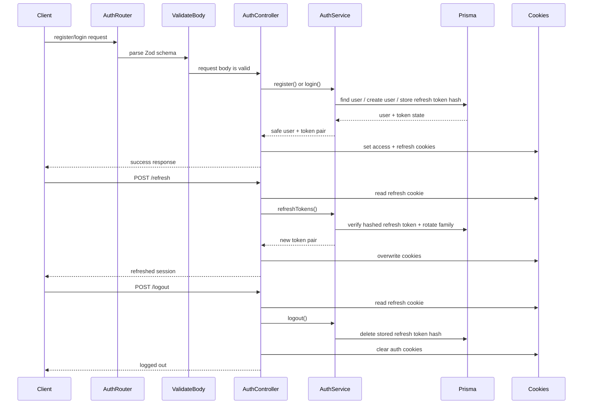

Notes:
- `register` always creates a student account; the role defaults to `STUDENT` in the Prisma schema.
- `login` rejects deactivated accounts and uses a vague credential error to avoid leaking whether the email exists.
- Refresh tokens are hashed before storage and are rotated on every refresh.
- Cookies are HTTP-only; the refresh cookie is scoped to `/api/auth`.
- `GET /api/auth/me` requires JWT verification and returns the safe user projection only.

## 2. User Module

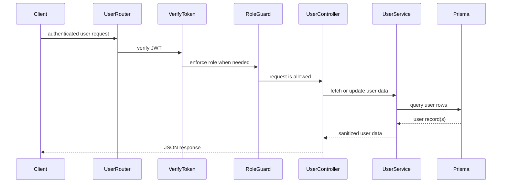

Notes:
- The user module follows the controller/service boundary; controllers do not query Prisma directly.
- Sensitive fields such as passwords are removed before the response is sent.
- Access is role-aware: admin/staff flows can fetch broader data than student self-service flows.

## 3. Class and Class Session Modules

Endpoints:
- `POST /api/classes`
- `GET /api/classes`
- `GET /api/classes/:classId`
- `PATCH /api/classes/:classId`
- `POST /api/classes/:classId/sessions`
- `GET /api/classes/:classId/sessions`
- `GET /api/classes/:classId/sessions/:sessionId`
- `PATCH /api/classes/:classId/sessions/:sessionId`
- `DELETE /api/classes/:classId/sessions/:sessionId`

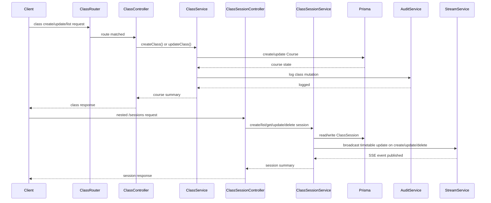

Notes:
- `classRoutes.use('/:classId/sessions', classSessionRoutes)` means session routes inherit the class ID parameter.
- Admin/staff can create, update, and delete classes and sessions; read routes are broader.
- Deleted sessions are soft-deleted with `deletedAt`, and non-admin readers do not see them.
- Session create/update/delete publishes `TIMETABLE_UPDATED` SSE events through `StreamService`.
- Class and session updates are audited non-blockingly from the controller layer.

## 4. Attendance Module

Endpoints:
- `POST /api/attendance/scan`
- `POST /api/attendance/zoom-webhook`
- `POST /api/attendance/manual`
- `POST /api/attendance/video`
- `GET /api/attendance/session/:sessionId`
- `GET /api/attendance/class/:classId`
- `GET /api/attendance/student/:userId`

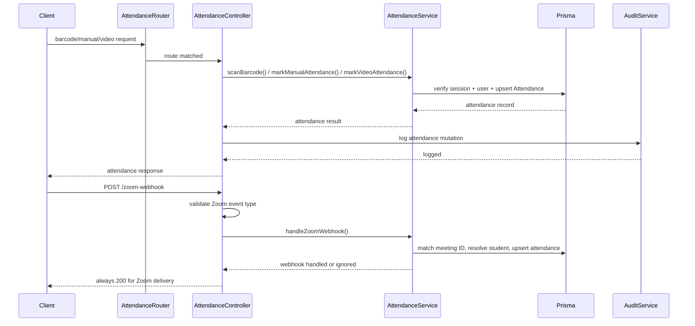

Notes:
- Barcode, manual, and video attendance all use `upsert` so duplicate scans do not create duplicate rows.
- The Zoom webhook is intentionally unauthenticated at the route level and is filtered by event type and payload validation.
- Video attendance is also stored through the attendance table, using the same unique key as live attendance.
- Query routes support session, course, and student views, with student self-access restricted to the same user unless the caller is staff/admin.

## 5. Exam Module

Endpoints:
- `POST /api/exams`
- `GET /api/exams`
- `GET /api/exams/:id`
- `PATCH /api/exams/:id`
- `DELETE /api/exams/:id`
- `POST /api/exams/:id/upload-url`
- `POST /api/exams/:id/assign-markers`

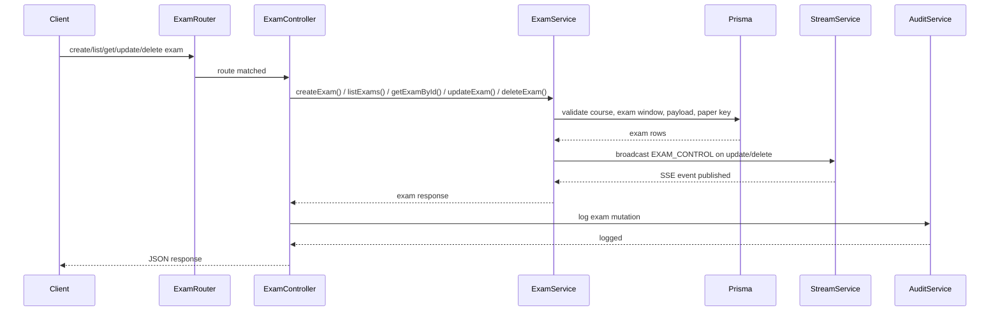

Notes:
- Exam creation validates that `endTime` is after `startTime` and that the MCQ payload matches the schema.
- Students only receive paper links and MCQ content when the exam window is active; the service strips answer keys from MCQ payloads.
- Paper uploads use presigned R2 URLs and store the R2 key back in the exam row.
- Updating or deleting an exam emits SSE control events so clients can react in real time.
- Marker assignment uses `createMany(..., skipDuplicates: true)` and validates every marker ID before writing.

## 6. Submission Module

Endpoints:
- `POST /api/submissions`
- `PATCH /api/submissions/:id/complete`
- `GET /api/submissions/exam/:examId`
- `PATCH /api/submissions/:id/marks`
- `POST /api/submissions/exam/:examId/publish`

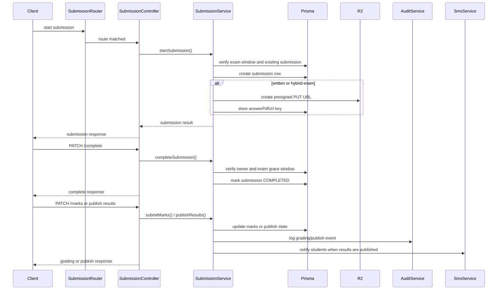

Notes:
- The start flow is server-authoritative: exam timing is checked with server time, not client time.
- MCQ exams can auto-grade immediately; written and hybrid exams receive a presigned upload URL for R2.
- `completeSubmission` is idempotent and enforces the owner's upload grace (`exams.uploadGraceSeconds`, default 180 seconds) after exam end for upload finalization.
- Mark submission requires an idempotency key at the route level to prevent double grading on retries.
- Result publishing triggers both audit logging and SMS notifications as non-blocking side effects.

## 7. Payment Module

Endpoints:
- `POST /api/payments/initiate`
- `POST /api/payments/payhere/checkout`
- `POST /api/payments/payhere/notify`
- `GET /api/payments/payhere/status/:id`
- `GET /api/payments`
- `GET /api/payments/my`
- `GET /api/payments/:id`
- `PATCH /api/payments/:id/override`
- `POST /api/payments/bulk-upload`

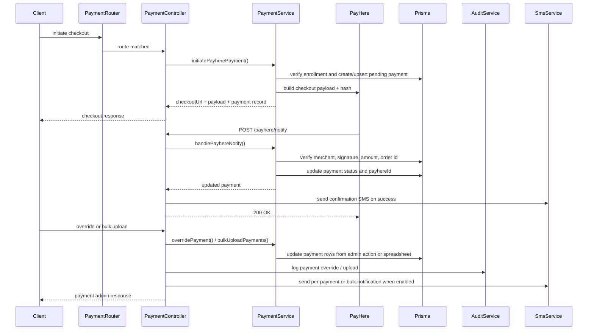

Notes:
- The checkout flow is idempotent through the route-level `checkIdempotency` middleware.
- The webhook is signature-verified against PayHere config and does not depend on auth cookies.
- Payment status transitions are resolved from PayHere status codes into `PENDING`, `SUCCESS`, or `FAILED`.
- Confirmation SMS and override SMS are best-effort side effects and do not block the response.
- Bulk upload uses in-memory multer storage and a size cap from `PAYMENTS_BULK_UPLOAD_MAX_BYTES`.

## 8. Video Module

Endpoints:
- `POST /api/videos`
- `PATCH /api/videos/:id`
- `DELETE /api/videos/:id`
- `GET /api/videos/class/:classId`
- `GET /api/videos/:id`
- `GET /api/videos/:id/stream`

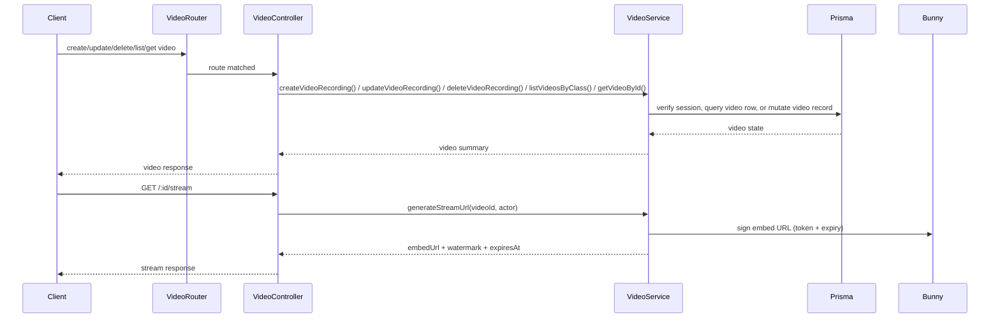

Notes:
- Video records are attached to existing class sessions; deleted sessions are rejected.
- The `/stream` endpoint binds the Bunny token to `req.ip`, so shared links fail outside the originating IP.
- Deleting a video removes only the database record; the Bunny asset remains untouched.
- Listing videos excludes sessions that were soft-deleted.

## 9. Stream and SSE Module

Endpoints and events:
- `GET /api/stream`
- `TIMETABLE_UPDATED`
- `EXAM_CONTROL`
- `RESULTS_PUBLISHED`

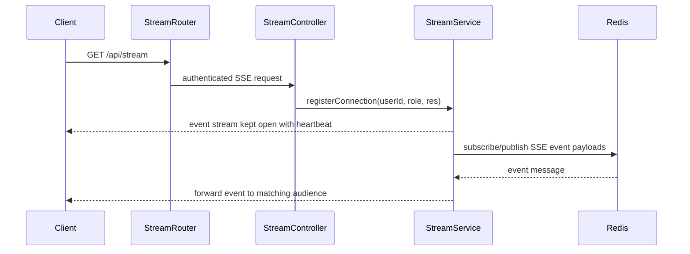

Notes:
- SSE connections are authenticated and long-lived; the server sends heartbeat messages to keep them alive.
- The service uses Redis pub/sub when available and falls back to local instance delivery if Redis is unavailable.
- Audience filtering can target user IDs, roles, or course-scoped events.
- Exam updates, timetable updates, and published results are all pushed through this channel.

## 10. Audit and Logging Module

Endpoints:
- `GET /api/audit-logs`

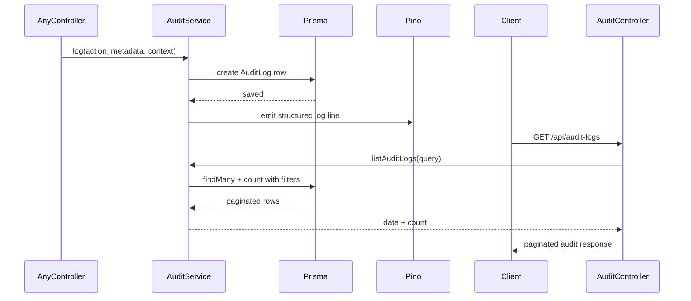

Notes:
- The controller no longer imports Prisma directly; the service owns the database query.
- Audit writes are fire-and-forget and never block the main mutation response.
- The list endpoint supports action, actor, target, and date-range filters.

## 11. Request Pipeline and Middleware Order

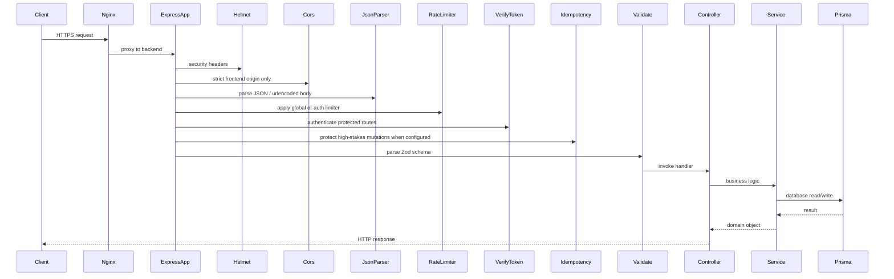

Notes:
- `app.set('trust proxy', 1)` is enabled, so `req.ip` and forwarded headers are respected behind a proxy.
- The global health check is exposed at `/api/health`.
- The error handler is mounted last.

## 12. Database and Infrastructure Module

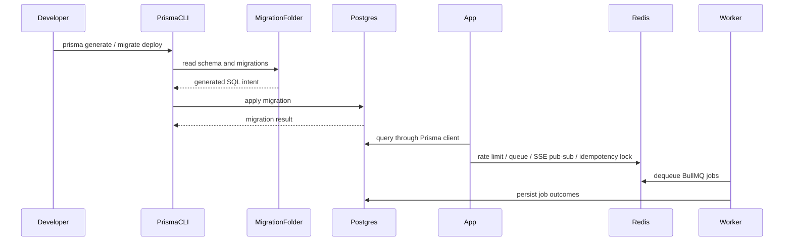

Notes:
- The Prisma schema is the source of truth for relational data and unique constraints.
- Redis is shared by rate limiting, queueing, SSE pub/sub, and idempotency locks.
- Background jobs are handled by a separate worker process, not the HTTP server.

## 13. Frontend Module

Sections:
- `/app/page.tsx`
- `/app/home/page.tsx`
- `/app/auth/login/page.tsx`
- `/app/auth/signup/page.tsx`
- `/app/layout.tsx`

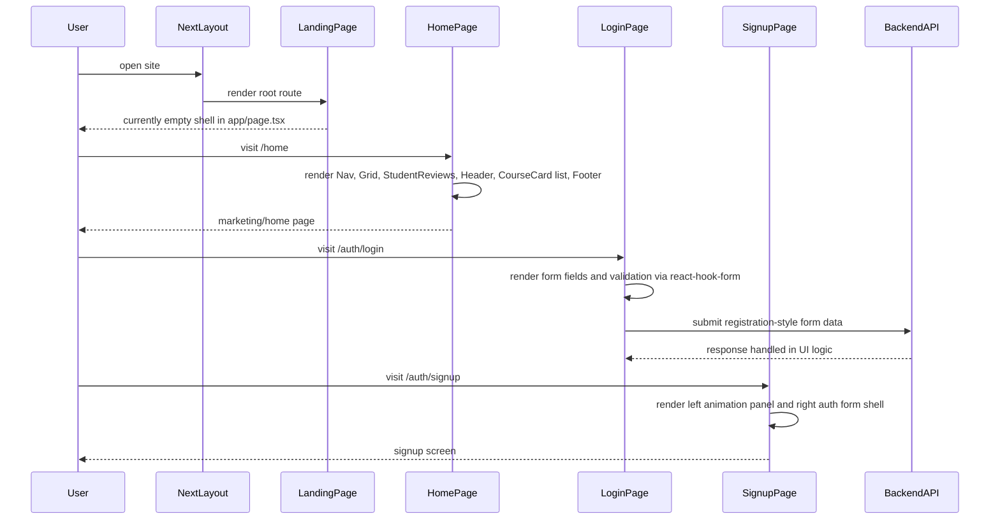

Notes:
- `app/layout.tsx` applies the Poppins font and global metadata for the app shell.
- `app/page.tsx` is currently an empty centered container, so the root route does not yet show functional content.
- `app/home/page.tsx` is the visible marketing page with navigation, reviews, header, course cards, and footer.
- The `/auth/login` UI currently renders registration-style fields in the codebase, so the route name and visible form content are not perfectly aligned.

If you want, I can split this into one Markdown file per module next, or turn any single section into a deeper endpoint-level diagram with request/response notes.
