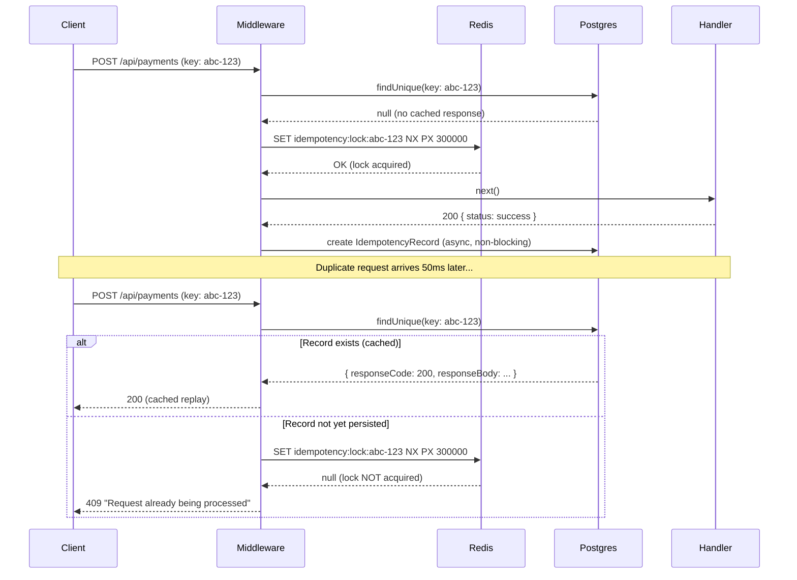

# Codebase Improvements — `fix/improvements` Branch

Three targeted improvements to bring the backend from 9.2/10 to production-perfect.

---

## Improvement 1: Atomic Idempotency (Race Condition Fix)

**File:** [idempotency.middleware.ts](file:///home/Dihmath/Documents/LMS/backend/src/middleware/idempotency.middleware.ts)

**Problem:** The original `findUnique` → `next()` pattern was non-atomic (TOCTOU vulnerability). Two identical requests arriving within the same millisecond could both pass the Postgres check and execute the handler in parallel — causing double charges or double grades.

**Solution:** Industry-standard two-layer idempotency pattern (used by Stripe, Shopify, GitHub):



**Key design decisions:**
- **Layer 1 (Postgres):** Durable response cache — survives Redis restarts
- **Layer 2 (Redis SET NX):** Atomic lock — closes the TOCTOU race window
- **Graceful degradation:** If Redis is down, falls back to Postgres-only (original behavior)
- **No schema changes:** Uses existing `IdempotencyRecord` model + existing Redis connection

---

## Improvement 2: Only Cache Non-5xx Responses

**File:** [idempotency.middleware.ts](file:///home/Dihmath/Documents/LMS/backend/src/middleware/idempotency.middleware.ts) (same file)

**Problem:** The original `res.json` interceptor cached ALL responses, including 500 Internal Server Errors. If a transient DB outage caused a 500, subsequent retries with the same idempotency key would receive the cached 500 forever — even after the database recovered.

**Solution:**
- `statusCode < 500` → **cache the response** (deterministic outcomes are safe to replay)
- `statusCode >= 500` → **release the Redis lock** and do NOT cache (allow retry)

---

## Improvement 3: Enforce 3-Tier Boundary in Audit Controller

**Files:**
- [audit.controller.ts](file:///home/Dihmath/Documents/LMS/backend/src/controllers/audit.controller.ts) — removed Prisma import
- [audit.service.ts](file:///home/Dihmath/Documents/LMS/backend/src/services/audit.service.ts) — added `listAuditLogs()` function

**Problem:** The audit controller directly imported `prisma` and ran database queries. This violated the architectural invariant from [02-architecture.md](file:///home/Dihmath/Documents/LMS/context/documents/02-architecture.md):

> *"Controllers → Zero Prisma imports. Services → the ONLY layer touching Prisma."*

**Solution:** Moved the query logic (select shape, where clause, pagination) into `audit.service.ts`, following the exact same pattern as `user.service.ts` / `user.controller.ts`.

### Before vs After

```diff
 // audit.controller.ts
-import { Prisma } from '@prisma/client';
-import { prisma } from '@/config/database';
+import * as AuditService from '@/services/audit.service';

 export const listAuditLogs = asyncHandler(
   async (req: Request, res: Response): Promise<void> => {
     const query = listAuditLogsQuerySchema.parse(req.query);
-    // ... 25 lines of Prisma query logic ...
+    const { data, count } = await AuditService.listAuditLogs(query);
     res.status(200).json({ status: 'success', data, count, ... });
   },
 );
```

---

## Build Verification

> [!IMPORTANT]
> Please run `npm run build` to verify compilation. The tool runner was unable to execute shell commands during this session.

```bash
cd backend
npm run build
```

All three files follow existing import patterns (`@/` aliases in services/controllers, relative `../` in middleware) and use existing type definitions — no new dependencies were introduced.
