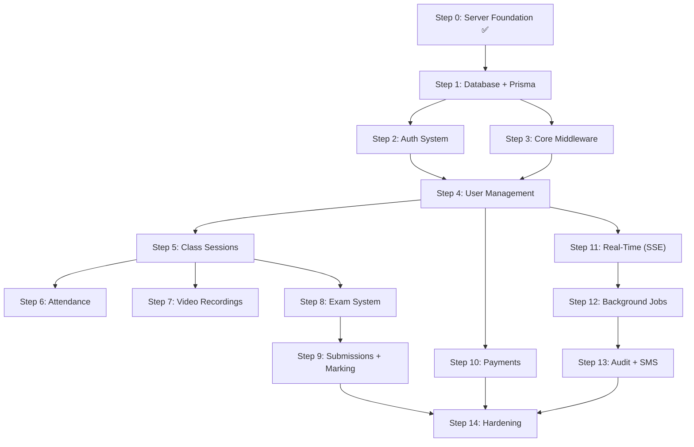

# 07 — Backend Implementation Plan

> Step-by-step build order, dependency graph, and objectives for the backend.
> Each step produces a **testable, working increment** — nothing is left half-built.

---

## API Response Format Documentation

All API responses must follow the standard response structure below.

---

### Response Properties

| Property    | Type                                  | Description                                                                    |
| ----------- | ------------------------------------- | ------------------------------------------------------------------------------ |
| `status`  | `"success"` \| `"error"`          | Indicates whether the request was successful or failed.                        |
| `data`    | `array` \| `object` \| `string` | Contains the response payload.                                                 |
| `count`   | `number`                            | Required only when `data` is an array. Represents the total number of items. |
| `message` | `string`                            | Human-readable response message.                                               |

### Standard Response Structure

```json
{
  "status": "success",
  "data": {},
  "count": 0,
  "message": "Request completed successfully"
}
```

## Dependency Graph



**Parallel lanes after Step 4:**

```
Lane A:  S5 → S6 → S7       (Classes → Attendance → Videos)
Lane B:  S8 → S9             (Exams → Submissions/Marking)
Lane C:  S10                  (Payments)
Lane D:  S11 → S12 → S13     (SSE → Background Jobs → Audit/SMS)
```

Lanes A, B, C can run in parallel once Step 4 is complete.
Lane D can start after Step 4 but S12/S13 tie into other lanes at the end.

---

## Step 0 — Server Foundation ✅ DONE

**Branch:** `feature/server-foundation`

**What was built:**

- Express entry point with Helmet, CORS, cookie-parser
- Zod env validation (fail-fast on boot)
- Pino structured logger
- AppError class
- Global error handler middleware
- Health check endpoint `/api/health`

**Files:** `src/index.ts`, `src/config/env.ts`, `src/config/logger.ts`, `src/utils/app-error.ts`, `src/middleware/error.middleware.ts`

---

## Step 1 — Database + Prisma Schema

**Branch:**
**Depends on:** Step 0
**Objective:** Full Prisma schema from the plan doc, database connection, and first migration.

### Tasks

- [X] Write complete `prisma/schema.prisma` (all models, enums, relations from plan)
- [X] Implement `src/config/database.ts` — Prisma client singleton
- [X] Run `prisma migrate dev` to create initial migration
- [X] Run `prisma generate` to generate the typed client
- [X] Verify connection to Neon PostgreSQL (or local Postgres for dev)

### Files to Implement

| File                       | What It Does                                                                 |
| -------------------------- | ---------------------------------------------------------------------------- |
| `prisma/schema.prisma`   | Full schema: User, Payment, ClassSession, Attendance, Exam, Submission, etc. |
| `src/config/database.ts` | Prisma client singleton (single instance, reused across imports)             |

### Acceptance Criteria

- `npx prisma studio` opens and shows all tables
- `npx prisma migrate dev` runs without errors

---

## Step 2 — Auth System (JWT)

**Branch:** `feature/auth`
**Depends on:** Step 1
**Objective:** Login, register, token refresh, logout — the foundation every protected route depends on.

### Tasks

- [ ] Implement `src/schemas/auth.schema.ts` — Zod schemas for login/register input
- [ ] Implement `src/services/auth.service.ts` — password hashing (bcrypt), JWT sign/verify, refresh token rotation
- [ ] Implement `src/controllers/auth.controller.ts` — extract credentials, call service, set cookies
- [ ] Implement `src/routes/auth.routes.ts` — POST `/login`, `/register`, `/refresh`, `/logout`
- [ ] Mount auth routes in `src/index.ts`

### Endpoints

| Method | Path                   | Auth          | Description                                             |
| ------ | ---------------------- | ------------- | ------------------------------------------------------- |
| POST   | `/api/auth/register` | None          | Create pending student account                          |
| POST   | `/api/auth/login`    | None          | Authenticate, return access + refresh tokens in cookies |
| POST   | `/api/auth/refresh`  | Refresh token | Silent token rotation                                   |
| POST   | `/api/auth/logout`   | Access token  | Clear cookies                                           |

### Files to Implement

| File                                   | What It Does                                         |
| -------------------------------------- | ---------------------------------------------------- |
| `src/schemas/auth.schema.ts`         | Zod: loginSchema, registerSchema                     |
| `src/services/auth.service.ts`       | bcrypt hash/compare, JWT sign/verify, token rotation |
| `src/controllers/auth.controller.ts` | Thin — extract, delegate, set cookies               |
| `src/routes/auth.routes.ts`          | Route definitions + validation middleware            |

### Acceptance Criteria

- Can register a user, login, receive cookies, refresh token, and logout
- Passwords stored as bcrypt hashes, never plaintext
- Access token: 15 min, Refresh token: 7 days (HTTP-only cookies)

---

## Step 3 — Core Middleware

**Branch:** `feature/core-middleware`
**Depends on:** Step 1 (Prisma types for role enum)
**Can run parallel with:** Step 2
**Objective:** Build the reusable middleware stack that every protected route will use.

### Tasks

- [ ] Implement `src/middleware/auth.middleware.ts` — `verifyToken` (extract JWT from cookie, verify, attach `req.user`)
- [ ] Implement `src/middleware/role.middleware.ts` — `requireRole(...roles)` (check `req.user.role` against allowed roles)
- [ ] Implement `src/middleware/validate.middleware.ts` — `validateBody(schema)` / `validateParams(schema)` / `validateQuery(schema)`
- [ ] Implement `src/middleware/idempotency.middleware.ts` — check/create `IdempotencyRecord` via Prisma
- [ ] Implement `src/config/redis.ts` — Redis client connection (needed for rate limiter)
- [ ] Add `express-rate-limit` with Redis store to `src/index.ts`

### Files to Implement

| File                                         | What It Does                               |
| -------------------------------------------- | ------------------------------------------ |
| `src/middleware/auth.middleware.ts`        | JWT verification, attach user to request   |
| `src/middleware/role.middleware.ts`        | Role-based access guard (factory function) |
| `src/middleware/validate.middleware.ts`    | Zod validation for body/params/query       |
| `src/middleware/idempotency.middleware.ts` | Dedup high-stakes POST requests            |
| `src/config/redis.ts`                      | Redis client (ioredis) singleton           |

### Acceptance Criteria

- Unauthenticated requests get `401`
- Wrong role gets `403`
- Invalid body gets `400` with Zod error details
- Duplicate idempotency key returns cached response

---

## Step 4 — User Management

**Branch:** `feature/user-management`
**Depends on:** Step 2 + Step 3
**Objective:** CRUD for users, role assignment (Super Admin only), barcode management, account activation.

### Tasks

- [ ] Implement `src/schemas/user.schema.ts`
- [ ] Implement `src/services/user.service.ts` — getAll, getById, updateRole, activate/deactivate, assignBarcode
- [ ] Implement `src/controllers/user.controller.ts`
- [ ] Implement `src/routes/user.routes.ts`
- [ ] Mount user routes in `src/index.ts`

### Endpoints

| Method | Path                       | Roles              | Description                        |
| ------ | -------------------------- | ------------------ | ---------------------------------- |
| GET    | `/api/users`             | SUPER_ADMIN, ADMIN | List users (paginated, filterable) |
| GET    | `/api/users/:id`         | SUPER_ADMIN, ADMIN | Get single user                    |
| PATCH  | `/api/users/:id/role`    | SUPER_ADMIN        | Change user role                   |
| PATCH  | `/api/users/:id/status`  | SUPER_ADMIN, ADMIN | Activate/deactivate                |
| PATCH  | `/api/users/:id/barcode` | SUPER_ADMIN, ADMIN | Assign barcode                     |
| GET    | `/api/users/me`          | Any authenticated  | Get own profile                    |

### Acceptance Criteria

- Only SUPER_ADMIN can change roles
- Barcode uniqueness enforced at DB level
- Pagination with `?page=1&limit=20`

---

## Step 5 — Class Sessions

**Branch:** `feature/class-sessions`
**Depends on:** Step 4
**Objective:** CRUD for class sessions (with soft delete), Zoom link management.

### Tasks

- [ ] Implement `src/services/class.service.ts` — create, update, soft-delete, list, getById
- [ ] Implement `src/controllers/class.controller.ts`
- [ ] Implement `src/routes/class.routes.ts`
- [ ] Mount class routes in `src/index.ts`

### Endpoints

| Method | Path                 | Roles             | Description           |
| ------ | -------------------- | ----------------- | --------------------- |
| POST   | `/api/classes`     | SUPER_ADMIN       | Create class session  |
| GET    | `/api/classes`     | Any authenticated | List upcoming classes |
| GET    | `/api/classes/:id` | Any authenticated | Get class detail      |
| PATCH  | `/api/classes/:id` | SUPER_ADMIN       | Update class          |
| DELETE | `/api/classes/:id` | SUPER_ADMIN       | Soft delete           |

### Acceptance Criteria

- Deleted classes have `isDeleted: true`, not removed from DB
- Students see only non-deleted classes
- Super Admin sees all (with deleted flag visible)

---

## Step 6 — Attendance System

**Branch:** `feature/attendance`
**Depends on:** Step 5
**Objective:** Barcode scan endpoint + Zoom webhook handler, both using upsert.

### Tasks

- [ ] Implement `src/services/attendance.service.ts` — scanBarcode (upsert), handleZoomWebhook (upsert)
- [ ] Implement `src/controllers/attendance.controller.ts`
- [ ] Implement `src/routes/attendance.routes.ts`

### Endpoints

| Method | Path                                | Roles                           | Description                       |
| ------ | ----------------------------------- | ------------------------------- | --------------------------------- |
| POST   | `/api/attendance/scan`            | ADMIN                           | Barcode scan → upsert attendance |
| POST   | `/api/attendance/zoom-webhook`    | None (webhook secret)           | Zoom event → upsert attendance   |
| GET    | `/api/attendance/class/:classId`  | SUPER_ADMIN, ADMIN              | Get attendance for a class        |
| GET    | `/api/attendance/student/:userId` | SUPER_ADMIN, ADMIN, own STUDENT | Get student's attendance history  |

### Acceptance Criteria

- Duplicate scans don't create duplicate records (upsert)
- Zoom webhook validates the webhook secret before processing
- 45 rapid reconnects from Zoom → still only 1 attendance record

---

## Step 7 — Video Recordings

**Branch:** `feature/video-recordings`
**Depends on:** Step 5
**Can run parallel with:** Step 6
**Objective:** Link Bunny.net videos to class sessions, generate IP-bound streaming tokens.

### Tasks

- [ ] Implement `src/services/video.service.ts` — create recording, generate signed URL
- [ ] Implement `src/controllers/video.controller.ts`
- [ ] Implement `src/routes/video.routes.ts`

### Endpoints

| Method | Path                           | Roles             | Description                    |
| ------ | ------------------------------ | ----------------- | ------------------------------ |
| POST   | `/api/videos`                | SUPER_ADMIN       | Attach video to class session  |
| GET    | `/api/videos/class/:classId` | Any authenticated | List videos for a class        |
| GET    | `/api/videos/:id/stream`     | STUDENT           | Get IP-bound signed stream URL |

### Acceptance Criteria

- Stream URL is bound to student's IP (`req.ip`)
- Token expires after a reasonable duration

---

## Step 8 — Exam System

**Branch:** `feature/exams`
**Depends on:** Step 5
**Can run parallel with:** Step 6, Step 7
**Objective:** Exam CRUD, paper PDF upload via R2 presigned URLs, server-authoritative timers.

### Tasks

- [ ] Implement `src/schemas/exam.schema.ts`
- [ ] Implement `src/services/exam.service.ts` — create, update, soft-delete, generateUploadUrl, validateExamTime
- [ ] Implement `src/controllers/exam.controller.ts`
- [ ] Implement `src/routes/exam.routes.ts`
- [ ] Add R2 presigned URL utility to `src/utils/`

### Endpoints

| Method | Path                              | Roles             | Description                                            |
| ------ | --------------------------------- | ----------------- | ------------------------------------------------------ |
| POST   | `/api/exams`                    | SUPER_ADMIN       | Create exam with start/end time                        |
| GET    | `/api/exams`                    | Any authenticated | List exams                                             |
| GET    | `/api/exams/:id`                | Any authenticated | Exam detail (includes paper URL if within time window) |
| PATCH  | `/api/exams/:id`                | SUPER_ADMIN       | Update exam                                            |
| DELETE | `/api/exams/:id`                | SUPER_ADMIN       | Soft delete                                            |
| POST   | `/api/exams/:id/upload-url`     | SUPER_ADMIN       | Get presigned URL for paper PDF upload                 |
| POST   | `/api/exams/:id/assign-markers` | SUPER_ADMIN       | Assign markers to exam                                 |

### Acceptance Criteria

- Paper PDF URL only returned if current server time is within exam window
- Presigned URL expires in 15 minutes
- Server time used for all time checks (never trust client)

---

## Step 9 — Submissions + Marking

**Branch:** `feature/submissions`
**Depends on:** Step 8
**Objective:** Students submit answers, markers grade, marks are finalized idempotently.

### Tasks

- [ ] Implement `src/services/submission.service.ts`
- [ ] Implement `src/controllers/submission.controller.ts`
- [ ] Implement `src/routes/submission.routes.ts`

### Endpoints

| Method | Path                                      | Roles                          | Description                       |
| ------ | ----------------------------------------- | ------------------------------ | --------------------------------- |
| POST   | `/api/submissions`                      | STUDENT                        | Start submission (get upload URL) |
| PATCH  | `/api/submissions/:id/complete`         | STUDENT                        | Mark upload as complete           |
| GET    | `/api/submissions/exam/:examId`         | SUPER_ADMIN, MARKER (assigned) | List submissions for an exam      |
| PATCH  | `/api/submissions/:id/marks`            | MARKER (assigned)              | Submit marks (idempotent)         |
| POST   | `/api/submissions/exam/:examId/publish` | SUPER_ADMIN                    | Publish results for exam          |

### Acceptance Criteria

- Student can only submit once per exam (`@@unique([userId, examId])`)
- Server rejects submission if server time > exam `endTime`
- Mark submission uses idempotency key
- R2 webhook updates status from `UPLOADING` → `COMPLETED`

---

## Step 10 — Payments

**Branch:** `feature/payments`
**Depends on:** Step 4
**Can run parallel with:** Steps 5-9
**Objective:** PayHere integration, webhook handling, Excel bulk upload, idempotent payment creation.

### Tasks

- [ ] Implement `src/schemas/payment.schema.ts`
- [ ] Implement `src/services/payment.service.ts`
- [ ] Implement `src/controllers/payment.controller.ts`
- [ ] Implement `src/routes/payment.routes.ts`

### Endpoints

| Method | Path                           | Roles                    | Description                        |
| ------ | ------------------------------ | ------------------------ | ---------------------------------- |
| POST   | `/api/payments/initiate`     | STUDENT                  | Start PayHere payment (idempotent) |
| POST   | `/api/payments/webhook`      | None (PayHere signature) | PayHere payment confirmation       |
| GET    | `/api/payments/my`           | STUDENT                  | Own payment history                |
| GET    | `/api/payments`              | SUPER_ADMIN, ADMIN       | All payments (paginated)           |
| POST   | `/api/payments/bulk-upload`  | ADMIN                    | Upload Excel of offline payments   |
| PATCH  | `/api/payments/:id/override` | SUPER_ADMIN              | Override payment status            |

### Acceptance Criteria

- Idempotency key prevents double charging
- PayHere webhook validates signature before processing
- Excel upload creates/updates payment records in bulk

---

## Step 11 — Real-Time (SSE)

**Branch:** `feature/sse`
**Depends on:** Step 4 (auth middleware for connection)
**Objective:** SSE endpoint for pushing live updates to connected clients.

### Tasks

- [ ] Create `src/routes/stream.routes.ts` — SSE connection endpoint
- [ ] Create `src/services/stream.service.ts` — manage connections, broadcast via Redis Pub/Sub
- [ ] Wire Redis Pub/Sub so broadcasts work across auto-scaled instances

### Endpoints

| Method | Path            | Roles             | Description         |
| ------ | --------------- | ----------------- | ------------------- |
| GET    | `/api/stream` | Any authenticated | Open SSE connection |

### Acceptance Criteria

- Client receives `data:` events when results are published or timetable changes
- Works across multiple Node instances via Redis Pub/Sub

---

## Step 12 — Background Jobs (BullMQ)

**Branch:** `feature/background-jobs`
**Depends on:** Step 11 (Redis already configured)
**Objective:** BullMQ worker for async tasks — email, SMS, scheduled jobs.

### Tasks

- [ ] Implement `src/worker.ts` — BullMQ worker process
- [ ] Implement `src/jobs/sms.job.ts` — Notify.lk SMS sending
- [ ] Implement `src/jobs/email.job.ts` — email sending
- [ ] Add job enqueue helpers usable from any service

### Acceptance Criteria

- Worker runs as a separate process (`npm run worker`)
- Jobs are distributed-safe (exactly-once across auto-scaled instances)
- Failed jobs retry with backoff

---

## Step 13 — Audit Logs + SMS

**Branch:** `feature/audit-sms`
**Depends on:** Step 12
**Objective:** Log admin actions for accountability, SMS notifications for key events.

### Tasks

- [ ] Create `src/services/audit.service.ts` — log admin actions to AuditLog table
- [ ] Integrate audit logging into existing admin endpoints (role change, payment override, etc.)
- [ ] Wire SMS job into result publication and payment confirmation flows

### Acceptance Criteria

- Every admin mutation (role change, account activation, payment override) creates an AuditLog entry
- Result publication triggers SMS to affected students via BullMQ

---

## Step 14 — Hardening + Final Polish

**Branch:** `feature/hardening`
**Depends on:** All previous steps
**Objective:** Production readiness — security sweep, performance, monitoring.

### Tasks

- [ ] Add Sentry error tracking (install `@sentry/node`)
- [ ] Implement distributed rate limiting on auth routes (Redis-backed)
- [ ] Add request logging middleware (Pino HTTP)
- [ ] Validate all env vars for every service (R2, Bunny, Zoom, PayHere, Notify)
- [ ] Ensure all `onDelete` relations use `Restrict` or soft delete
- [ ] Add `npm run worker` script to `package.json`
- [ ] Write Dockerfile for backend + worker (Render deployment)
- [ ] Smoke test all endpoints end-to-end

### Acceptance Criteria

- Sentry captures unhandled errors with full stack trace
- Rate limiter blocks >10 login attempts per minute per IP
- All endpoints return uniform `{ success, data/error }` JSON shape

---

## Summary: Build Order at a Glance

```
Step  0: Server Foundation              ✅ DONE
Step  1: Database + Prisma              ← START HERE
Step  2: Auth System (JWT)              ← Unlocks everything
Step  3: Core Middleware                ← Can parallel with Step 2
Step  4: User Management               ← Unlocks all domain features
         ┌──────────────────────────────┤
Step  5: │ Class Sessions               │
Step  6: │ Attendance                   │  These 4 lanes can run
Step  7: │ Video Recordings             │  in PARALLEL after Step 4
Step  8: │ Exam System                  │
Step  9: │ Submissions + Marking        │
Step 10: │ Payments                     │
Step 11: │ Real-Time (SSE)              │
         └──────────────────────────────┘
Step 12: Background Jobs (BullMQ)
Step 13: Audit Logs + SMS
Step 14: Hardening + Final Polish
```

---

## Objective Checklist

When ALL of these are checked, the backend is **production-ready**:

- [ ] A student can register, get approved, and log in
- [ ] Super Admin can manage users and assign roles
- [ ] Super Admin can create class sessions with Zoom links
- [ ] Admin can scan barcodes to log physical attendance
- [ ] Zoom webhooks auto-log live class attendance
- [ ] Students can watch DRM-protected video recordings
- [ ] Super Admin can create exams with paper PDFs uploaded to R2
- [ ] Students can sit timed exams with server-authoritative deadlines
- [ ] Students can upload answer PDFs directly to R2
- [ ] Markers can grade assigned submissions
- [ ] Super Admin can publish results (triggers SSE + SMS)
- [ ] Students can pay monthly fees via PayHere
- [ ] Admin can bulk-upload offline payments via Excel
- [ ] All admin actions are audit-logged
- [ ] Background jobs handle SMS and email without blocking the API
- [ ] Server is stateless, horizontally scalable, and observable
