# 08 — Database Design

> Production-ready PostgreSQL schema via Prisma ORM.
> Every table, relation, index, and constraint is here with the **why** behind each decision.
>
> **This document is the schema source of truth.** Where the current `backend/prisma/schema.prisma` differs, the code must be migrated to match (see [§12 Code Drift](#12-code-drift--required-migrations)). No production data exists yet, so these are safe pre-launch changes.
>
> **Tenancy (decided 2026-11-19; step M1 migrated):** every model now carries a nullable `organizationId` (default: the `default` organization) with an `Organization` relation and index; `NOT NULL`, the scoped client and the per-organization uniques are M2–M3. Several global uniques will become per-organization. The model blocks in §4 show the schema **without** these tenancy columns (and some predate later columns, noted where known — `backend/prisma/schema.prisma` is authoritative for what exists today); the exact additions and constraint changes are listed once in [14-multi-tenancy-readiness.md](./14-multi-tenancy-readiness.md) §3 and in [§12 Code Drift](#12-code-drift--required-migrations) rather than repeated on every model. Planned models below are marked **(planned)**.

---

## 1. Design Principles

| Principle | Rule |
| --- | --- |
| **Soft deletes** | Models with child relations use `deletedAt DateTime?` — never hard delete. A nullable timestamp tells you *when* it was deleted. |
| **Restrict cascades** | All FK `onDelete` rules are `Restrict` (block) or `SetNull`. Never `Cascade` in production. |
| **UUID primary keys** | `@default(uuid())` — non-sequential, safe to expose in URLs, no ID enumeration. |
| **Human-readable index** | Every user gets a sequential `indexNumber` (`autoincrement()`), formatted `LMS-0001` at the app layer. UUID stays the internal FK. |
| **Consistent timestamps** | Every model gets `createdAt` + `updatedAt` (except append-only logs, which need only `createdAt`). |
| **Indexed foreign keys** | Every FK column is indexed for JOIN performance. Prisma does not auto-index FKs. |
| **Composite unique constraints** | Enforce business rules at the DB level (one submission per student per exam, one payment per enrollment per month). |
| **Enums for fixed states** | Roles, statuses, sources use Postgres enums — type-safe and self-documenting. |
| **Money is `Decimal`** | `@db.Decimal(10,2)` — never `Float`. |
| **Normalized (3NF)** | With documented pragmatic denormalizations (MCQ JSONB, address on User). See §11. |
| **Tenant-owned by default** | Once the organization migration lands, a new table without `organizationId` must be justified in review and listed in the non-tenant allowlist; a registry test enforces it. |

---

## 2. Entity Relationship Diagram

```mermaid
erDiagram
    %% ─── IDENTITY ───
    USER ||--o{ REFRESH_TOKEN : "owns"
    USER ||--o{ ENROLLMENT : "enrolls in"
    USER ||--o{ COURSE : "teaches (as TEACHER)"
    USER ||--o{ SUBJECT_TEACHER : "approved for subject"
    SUBJECT ||--o{ SUBJECT_TEACHER : "has approved teachers"
    USER ||--o{ COURSE_CONTENT_PROGRESS : "tracks seen content"
    COURSE ||--o{ COURSE_CONTENT_PROGRESS : "tracks learner progress"
    USER ||--o{ AUDIT_LOG : "acts in"
    USER |o--o{ SMS_LOG : "receives"

    %% ─── ACADEMIC HIERARCHY ───
    SUBJECT ||--o{ COURSE : "contains"
    COURSE ||--o{ ENROLLMENT : "has students"
    COURSE ||--o{ CLASS_SESSION : "schedules"
    COURSE ||--o{ EXAM : "assigns"
    ENROLLMENT ||--o{ PAYMENT : "pays for"

    %% ─── ACADEMICS ───
    USER ||--o{ ATTENDANCE : "logs"
    CLASS_SESSION ||--o{ ATTENDANCE : "tracks"
    CLASS_SESSION ||--o{ VIDEO_RECORDING : "contains"

    %% ─── EXAMS ───
    USER ||--o{ SUBMISSION : "submits"
    USER ||--o{ MARKER_ASSIGNMENT : "assigned as marker"
    EXAM ||--o{ SUBMISSION : "receives"
    EXAM ||--o{ MARKER_ASSIGNMENT : "requires"

    USER {
        uuid id PK
        int indexNumber UK "auto-increment - LMS-0001"
        string email UK "login identifier"
        string name
        string nic UK "nullable - National ID"
        string phone "nullable - for SMS + QR/payment lookup"
        string address "nullable"
        string city "nullable"
        string password "bcrypt hash"
        string barcode UK "nullable - QR/barcode value for entrance scan"
        enum role "SUPER_ADMIN TEACHER ADMIN MARKER STUDENT"
        datetime deletedAt "nullable - soft delete"
    }


    SUBJECT {
        uuid id PK
        string name UK "e.g. Physics, Chemistry"
        string description "nullable"
        boolean isActive "default true"
    }

    SUBJECT_TEACHER {
        uuid id PK
        uuid subjectId FK
        uuid teacherId FK
        datetime assignedAt
    }

    COURSE {
        uuid id PK
        uuid subjectId FK "references Subject"
        uuid teacherId FK "references User (TEACHER)"
        string name "e.g. 2026 Theory"
        int year
        decimal monthlyFee "Decimal 10,2"
        string description "nullable"
        boolean isActive "default true"
    }

    ENROLLMENT {
        uuid id PK
        uuid userId FK "student"
        uuid courseId FK
        enum classType "ONLINE PHYSICAL"
        boolean isActive "default true"
    }

    COURSE_CONTENT_PROGRESS {
        uuid id PK
        uuid userId FK
        uuid courseId FK
        datetime lastSeenAt
        datetime updatedAt
    }

    PAYMENT {
        uuid id PK
        decimal amount "Decimal 10,2"
        enum status "PENDING SUCCESS FAILED"
        enum method "ONLINE ENTRANCE BULK MANUAL"
        string payhereId UK "nullable - PayHere txn ref"
        string paymentMonth "YYYY-MM"
        string note "nullable - admin note"
        uuid enrollmentId FK
        uuid collectedById FK "nullable - staff who took entrance/manual payment"
    }

    CLASS_SESSION {
        uuid id PK
        uuid courseId FK
        string title
        string description "nullable"
        enum classType "nullable - null = all cohorts"
        datetime date
        int durationMinutes "default 60"
        string zoomLink "nullable - present = live-streamed"
        string zoomMeetingId "nullable - webhook matching"
        datetime deletedAt "nullable - soft delete"
    }

    ATTENDANCE {
        uuid id PK
        enum source "QR BARCODE ZOOM_WEBHOOK MANUAL"
        datetime scannedAt
        datetime lastSeenAt "updated on reconnects"
        uuid userId FK
        uuid classSessionId FK
    }

    VIDEO_RECORDING {
        uuid id PK
        string title
        string bunnyVideoId
        int durationSeconds "nullable"
        uuid classSessionId FK
    }

    EXAM {
        uuid id PK
        uuid courseId FK
        string title
        enum type "MCQ WRITTEN HYBRID INCLASS"
        string paperPdfUrl "nullable - R2 URL"
        json mcqPayload "nullable - questions JSONB"
        datetime startTime "server-authoritative"
        datetime endTime "server-authoritative"
        int totalMarks "default 100"
        boolean isPublished
        datetime deletedAt "nullable - soft delete"
    }

    SUBMISSION {
        uuid id PK
        enum status "UPLOADING COMPLETED"
        string answerPdfUrl "nullable - R2 URL"
        json answers "nullable - MCQ answers JSONB"
        int marks "nullable - until graded"
        string feedback "nullable - marker comments"
        uuid userId FK
        uuid examId FK
        datetime submittedAt
        datetime gradedAt "nullable"
    }

    MARKER_ASSIGNMENT {
        uuid id PK
        uuid markerId FK
        uuid examId FK
        datetime assignedAt
    }

    AUDIT_LOG {
        uuid id PK
        string action "e.g. ROLE_CHANGED"
        string description "nullable"
        string targetType "nullable - e.g. User Payment"
        string targetId "nullable"
        json metadata "nullable - before/after"
        string ip "nullable"
        string userAgent "nullable"
        uuid actorId FK "who performed the action"
        string actorRole "denormalized role at action time"
    }

    SMS_LOG {
        uuid id PK
        string phoneNumber
        string message
        enum status "PENDING SENT FAILED"
        decimal cost "nullable - Decimal 6,2"
        string errorDetail "nullable"
        uuid userId FK "nullable"
    }
```



---

## 3. Enums

| Enum | Values | Used By |
| --- | --- | --- |
| `Role` | `SUPER_ADMIN`, `TEACHER`, `ADMIN`, `MARKER`, `STUDENT` | User |
| `ClassType` | `ONLINE`, `PHYSICAL`; **`HYBRID` planned** (enrollment only) | Enrollment, ClassSession, TimetableSlot |
| `PaymentStatus` | `PENDING`, `SUCCESS`, `FAILED`, `REFUNDED` | Payment |
| `PaymentMethod` | `ONLINE`, `ENTRANCE`, `BULK`, `MANUAL`; **`BANK_TRANSFER` planned** | Payment |
| `PaymentSlipStatus` **(planned)** | `PENDING_UPLOAD`, `SUBMITTED`, `APPROVED`, `REJECTED`, `EXPIRED`, `SUPERSEDED` | PaymentSlip |
| `SubmissionStatus` | `UPLOADING`, `COMPLETED` | Submission |
| `AttendanceSource` | `QR`, `BARCODE`, `ZOOM_WEBHOOK`, `MANUAL` | Attendance |
| `SmsStatus` | `PENDING`, `SENT`, `FAILED` | SmsLog |
| `ExamType` | `MCQ`, `WRITTEN`, `HYBRID`, `INCLASS` | Exam |

### Design notes on enums

- **`Role`** — `SUPER_ADMIN` is the owner of one organization (one per organization by default, up to two with `identity.maxOwners`; today there is one organization). `PLATFORM_ADMIN` is a reserved name for the future SaaS operator and is **not** in the enum; `TEACHER` (many) teaches courses; `ADMIN` (many) is front-desk staff; `MARKER` grades assigned exams; `STUDENT`. This replaces the legacy `ADMIN/STAFF` mapping in the current code (§12).
- **`ClassType`** — `ONLINE` vs `PHYSICAL` today; **`HYBRID` is planned for enrollments** and means one enrollment, one fee, physical attendance plus online access. On `ClassSession` and `TimetableSlot`, `classType` is **nullable**: `null` means the session is for all cohorts (e.g. a physical class that is also streamed to online students); a session is never itself `HYBRID`. Eligibility rules are in the [payment channels and HYBRID design](../../docs/superpowers/specs/2026-11-19-payment-channels-and-hybrid-enrollment-design.md) §4.3.
- **`PaymentMethod`** — how a payment was collected: `ONLINE` (PayHere, on the platform), `ENTRANCE` (paid in person at the front desk or a branch), `BULK` (Excel import), `MANUAL` (admin/owner adjustment), and planned `BANK_TRANSFER` (student uploads a slip; staff approve). Enables channel-based reporting.
- **`AttendanceSource`** — `QR` (student shows their QR at the entrance, staff scans) or `BARCODE` (physical barcode card) — both are entrance scans; `ZOOM_WEBHOOK` (live-streamed class join); `MANUAL` (admin entry). A record existing = present; no record = absent.
- **`ExamType`** — a coarse label for the paper: `MCQ` (only an MCQ section), `WRITTEN` (only structured/essay), `HYBRID` (a mixed paper: MCQ + structured/essay), `INCLASS` (pure paper exam with no LMS submission — marker enters marks). The exam's `allowTypedAnswers` / `allowPdfUpload` flags decide which submission channels students may use; the same paper serves both online and physical cohorts.

---

## 4. Model-by-Model Design

### 4.1 User

```prisma
model User {
  id          String    @id @default(uuid())
  indexNumber Int       @unique @default(autoincrement()) // LMS-0001 at app layer
  email       String    @unique
  name        String
  nic         String?   @unique              // Sri Lankan NIC (old 9+V/X or new 12-digit)
  phone       String?                        // SMS via Notify.lk
  address     String?
  city        String?
  password    String                         // bcrypt hash
  barcode     String?   @unique              // LMS-issued QR code (global) — LMS-native entrance
  role        Role      @default(STUDENT)
  deletedAt   DateTime?                       // Soft delete — null means active

  // Account setup / onboarding
  setupCompleted Boolean @default(false)      // NIC uploaded + institute barcodes registered
  nicFrontUrl    String?                       // R2 key — NIC front photo (private)
  nicBackUrl     String?                       // R2 key — NIC back photo (private)

  // Relations
  enrollments       Enrollment[]
  taughtCourses     Course[]           @relation("CourseTeacher")   // courses this TEACHER teaches
  studentBarcodes   StudentBarcode[]                                // per-institute barcodes
  attendance        Attendance[]
  submissions       Submission[]
  auditLogs         AuditLog[]         @relation("AuditActor")
  markerAssignments MarkerAssignment[] @relation("AssignedMarker")
  smsLogs           SmsLog[]
  refreshTokens     RefreshToken[]
  collectedPayments Payment[]          @relation("PaymentCollector") // payments this staff collected

  createdAt DateTime @default(now())
  updatedAt DateTime @updatedAt

  @@index([email])
  @@index([nic])
  @@index([barcode])
  @@index([role])
}
```

- **`barcode`** holds the student's unique scan code. The frontend can render it as a **QR** (shown in the student app) *or* print it as a barcode card. Either way it maps to one student for entrance attendance and pay-at-entrance lookup.
- **`taughtCourses`** — a TEACHER owns the courses they teach (`Course.teacherId`).
- **`deletedAt`** is the universal "active" filter: `WHERE deletedAt IS NULL`.

### 4.2 Permission — removed (D-IDENTITY-4)

Never read or written by code; the `Permission` model is dropped in Wave 1b Task 7 (the migration refuses to run if any row exists). Authorization is the role plus resource and target guards.

### 4.3 RefreshToken

```prisma
model RefreshToken {
  id        String   @id @default(uuid())
  token     String   @unique                  // SHA-256 hash of the refresh token
  userId    String
  user      User     @relation(fields: [userId], references: [id], onDelete: Restrict)
  expiresAt DateTime
  createdAt DateTime @default(now())
  rotatedAt DateTime?                          // set when exchanged; a re-presentation within the grace window is tolerated

  @@index([userId])
  @@index([expiresAt])                         // cleanup: DELETE WHERE expiresAt < NOW()
}
```

Enables logout revocation, refresh-token family detection (reuse beyond `REFRESH_REUSE_GRACE_SECONDS` → revoke all), and a scheduled cleanup job. Rotated rows older than the grace window are deleted opportunistically on the user's next refresh.

### 4.4 IdempotencyRecord

```prisma
model IdempotencyRecord {
  id           String   @id @default(uuid())
  key          String   @unique
  route        String                          // scope by endpoint to avoid cross-route collisions
  responseCode Int
  responseBody Json
  createdAt    DateTime @default(now())

  @@index([key])
  @@index([createdAt])                         // cleanup: DELETE WHERE createdAt < NOW() - 24h
}
```

Paired with a Redis `SET NX` lock in middleware to close the TOCTOU race (see `Guides_And_Summeries/improvements_summary.md`).

### 4.5 Subject (top-level)

```prisma
model Subject {
  id          String   @id @default(uuid())
  name        String   @unique                 // Physics, Chemistry, Combined Maths
  description String?
  isActive    Boolean  @default(true)

  courses     Course[]

  createdAt DateTime @default(now())
  updatedAt DateTime @updatedAt

  @@index([isActive])
}
```

- The top of the academic hierarchy. A subject groups many courses. Managed by the Super Admin.

### 4.6 Course

```prisma
model Course {
  id          String   @id @default(uuid())
  name        String                           // e.g. "2026 Theory", "2026 Revision"
  year        Int
  description String?
  monthlyFee  Decimal  @db.Decimal(10, 2)      // default fee for this course
  isActive    Boolean  @default(true)
  bannerUrl   String?                          // server-controlled public CDN URL
  bannerKey   String?                          // public R2 key for replace/remove cleanup
  bannerAlt   String?                          // accessible image description
  backdropUrl String?                          // server-controlled public CDN URL
  backdropKey String?                          // public R2 key for replace/remove cleanup
  backdropAlt String?                          // accessible image description

  subjectId   String
  subject     Subject  @relation(fields: [subjectId], references: [id], onDelete: Restrict)

  teacherId   String
  teacher     User     @relation("CourseTeacher", fields: [teacherId], references: [id], onDelete: Restrict)

  enrollments   Enrollment[]
  classSessions ClassSession[]
  exams         Exam[]
  modules       CourseModule[]

  createdAt DateTime @default(now())
  updatedAt DateTime @updatedAt

  @@unique([subjectId, name, year])            // no duplicate course names per subject per year
  @@index([subjectId])
  @@index([teacherId])
  @@index([year])
  @@index([isActive])
}
```

- **`subjectId`** — belongs to exactly one Subject.
- **`teacherId`** — taught by exactly one Teacher (role `TEACHER`, enforced at service layer). A teacher teaching two subjects simply owns two courses.
- **`isActive`** (not `deletedAt`) — courses are retired, not deleted; they stop accepting new enrollments.
- Generic course create/update cannot write display URLs. Only the owning TEACHER or SUPER_ADMIN can
  confirm a server-issued course key after size, MIME, full-decode, and exact-dimension validation
  (banner 1600×600; backdrop 1920×1080).

### 4.6.1 CourseModule and CourseMaterial

`CourseModule` is an ordered, soft-removable learning unit with `DRAFT`/`PUBLISHED` state and an
optional `releaseAt`. `CourseMaterial` is an ordered, version-ready, soft-removable private file
record. It stores the verified MIME/size, server-normalized filename, download policy, and private
R2 key. List responses deliberately omit `objectKey`; download URLs are minted only after the
service repeats role, ownership, release, enrollment, and current-payment checks. Restrictive
foreign keys preserve academic history, while service-level removal hides rows and cleans tracked
objects best-effort.

### 4.7 Enrollment

```prisma
model Enrollment {
  id        String    @id @default(uuid())
  classType ClassType                          // ONLINE or PHYSICAL delivery mode
  isActive  Boolean   @default(true)

  userId    String
  user      User      @relation(fields: [userId], references: [id], onDelete: Restrict)

  courseId  String
  course    Course    @relation(fields: [courseId], references: [id], onDelete: Restrict)

  payments  Payment[]

  createdAt DateTime @default(now())
  updatedAt DateTime @updatedAt

  @@unique([userId, courseId, classType])      // one enrollment per student/course/mode
  @@index([userId])
  @@index([courseId])
  @@index([classType])
}
```

- A student can enroll in **multiple courses** across subjects; each enrollment is paid independently.
- **Access control**: a student sees a course's sessions/videos only via an **active enrollment**, with video access gated on the **current month being paid**. The gate does not currently look at `classType`.
- **Planned (HYBRID design §4.2):** add `HYBRID`; replace `@@unique([userId, courseId, classType])` with one **active** enrollment per `(userId, courseId)` (a nullable `activeKey` with a plain `@unique`, set only while `isActive`; Prisma cannot express partial unique indexes) so a student cannot be billed twice for one course; a mode change becomes an audited in-place update so existing payments stay linked. The migration merges existing duplicate active enrollments into one `HYBRID` row and refuses to run if a merge is ambiguous, including when both enrollments already have a payment for the same month (a double-billing case that needs a refund first).

### 4.8 Payment

```prisma
model Payment {
  id           String        @id @default(uuid())
  amount       Decimal       @db.Decimal(10, 2)
  status       PaymentStatus @default(PENDING)
  method       PaymentMethod @default(ONLINE)  // ONLINE | ENTRANCE | BULK | MANUAL
  payhereId    String?       @unique
  paymentMonth String                          // "2026-05"
  note         String?
  refundedAmount Decimal       @default(0) @db.Decimal(10, 2)

  enrollmentId String
  enrollment   Enrollment    @relation(fields: [enrollmentId], references: [id], onDelete: Restrict)

  collectedById String?                        // staff who took an ENTRANCE/MANUAL payment
  collectedBy   User?         @relation("PaymentCollector", fields: [collectedById], references: [id], onDelete: SetNull)

  adjustments PaymentAdjustment[]

  createdAt DateTime @default(now())
  updatedAt DateTime @updatedAt

  @@unique([enrollmentId, paymentMonth])       // one payment per enrollment per month
  @@index([enrollmentId])
  @@index([status])
  @@index([method])
  @@index([paymentMonth])
}
```

- **`enrollmentId`, not `userId`** — payment is tied to a specific enrollment (student + course + mode).
- **`method`** — records the channel. `ENTRANCE` payments are taken at the front desk; `collectedById` records which staff member took the cash. `ONLINE` = PayHere; `BULK` = Excel import; `MANUAL` = owner/admin adjustment.
- **`@@unique([enrollmentId, paymentMonth])`** — prevents double-paying the same month for the same enrollment (whether online, at the entrance or by bank transfer). It deliberately stays one row per month; slip attempts live in `PaymentSlip` (below) so reject → re-upload does not need to break it.
- **`collectedAtInstituteId` / `collectedViaBarcode`** — for `ENTRANCE` payments, the branch that took the cash and the barcode that identified the student (a snapshot, not a foreign key). These are present in the schema; the model block above predates them.
- **Tenancy:** `payhereId` becomes `@@unique([organizationId, payhereId])` (ADR 14 §3.3).
- **`amount` stays gross; `refundedAmount` is the net-reporting projection.** Partial refunds keep
  `SUCCESS`; a full refund sets `REFUNDED`, so content gates stop accepting the payment.

### 4.8.1 PaymentAdjustment

`PaymentAdjustment` is an append-only financial ledger for `OVERRIDE` and `REFUND` events. It stores
before/after payment status and gross-amount snapshots, refund amount where applicable, a required
reason, optional external reference, actor, and creation time. It intentionally has no `updatedAt` or
soft-delete field; the migration installs a PostgreSQL trigger rejecting `UPDATE` and `DELETE`.
`PaymentAdjustment → Payment` and `PaymentAdjustment → User` both use `onDelete: Restrict`.

### 4.8.2 PaymentSlip (planned)

Append-only evidence for bank-transfer payments. One `Payment` can have several slips (reject, then
re-upload). Statuses: `PENDING_UPLOAD → SUBMITTED → APPROVED | REJECTED`, or `EXPIRED` when an upload is
never confirmed. Approval is the only way a `BANK_TRANSFER` payment becomes `SUCCESS`; a pending slip
never unlocks content. Fields, constraints, API and edge cases are specified in the
[payment channels and HYBRID design](../../docs/superpowers/specs/2026-11-19-payment-channels-and-hybrid-enrollment-design.md)
§3. `PaymentSlip → Payment` uses `onDelete: Restrict`; objects are stored under a private,
organization-prefixed R2 key that is never exposed to clients.

### 4.9 ClassSession

```prisma
model ClassSession {
  id              String     @id @default(uuid())
  title           String
  description     String?
  classType       ClassType?                    // null = all cohorts (e.g. physical + streamed online)
  date            DateTime
  durationMinutes Int        @default(60)
  zoomLink        String?                        // present = live-streamed
  zoomMeetingId   String?                        // for Zoom webhook matching

  courseId        String
  course          Course     @relation(fields: [courseId], references: [id], onDelete: Restrict)

  deletedAt       DateTime?

  attendance      Attendance[]
  videoRecordings VideoRecording[]

  createdAt DateTime @default(now())
  updatedAt DateTime @updatedAt

  @@index([courseId])
  @@index([courseId, classType])
  @@index([date])
  @@index([deletedAt])
}
```

- **Delivery semantics**: `zoomLink` present ⇒ live-streamed (online students join; attendance via webhook). `classType = PHYSICAL` with a `zoomLink` ⇒ a physical class also streamed online. `classType = null` ⇒ visible to all enrolled cohorts. `videoRecordings` may be attached afterward regardless.

### 4.10 Attendance

```prisma
model Attendance {
  id             String           @id @default(uuid())
  source         AttendanceSource @default(QR)
  scannedAt      DateTime         @default(now())
  lastSeenAt     DateTime         @default(now())   // updated on Zoom reconnects

  userId         String
  user           User             @relation(fields: [userId], references: [id], onDelete: Restrict)

  classSessionId String
  classSession   ClassSession     @relation(fields: [classSessionId], references: [id], onDelete: Restrict)

  createdAt DateTime @default(now())
  updatedAt DateTime @updatedAt

  @@unique([userId, classSessionId])                // one record per student per session
  @@index([userId])
  @@index([classSessionId])
}
```

- **`source`** captures *how* attendance was logged (`QR`/`BARCODE` entrance scan, `ZOOM_WEBHOOK`, `MANUAL`).
- **`lastSeenAt`** + `upsert` solves the Zoom reconnect storm: 45 reconnects → 1 row, `lastSeenAt` updated.

### 4.11 VideoRecording

```prisma
model VideoRecording {
  id              String       @id @default(uuid())
  title           String
  bunnyVideoId    String                          // Bunny Stream video ID
  durationSeconds Int?

  classSessionId  String
  classSession    ClassSession @relation(fields: [classSessionId], references: [id], onDelete: Restrict)

  createdAt DateTime @default(now())
  updatedAt DateTime @updatedAt

  @@index([classSessionId])
}
```

### 4.12 Exam

```prisma
model Exam {
  id          String    @id @default(uuid())
  title       String
  type        ExamType  @default(HYBRID)         // coarse label; sections defined by the fields below
  paperPdfUrl String?                            // R2 URL — the written (structured/essay) question paper
  mcqPayload  Json?                              // JSONB — MCQ section (null = no MCQ section)

  // Which answer channels students may use (exam-wide; online + physical students alike)
  allowTypedAnswers Boolean @default(true)       // type structured/essay answers online
  allowPdfUpload    Boolean @default(true)       // upload a scanned/written A4 answer PDF

  startTime   DateTime
  endTime     DateTime
  totalMarks  Int       @default(100)
  isPublished Boolean   @default(false)

  courseId    String
  course      Course    @relation(fields: [courseId], references: [id], onDelete: Restrict)

  deletedAt   DateTime?

  submissions       Submission[]
  markerAssignments MarkerAssignment[]

  createdAt DateTime @default(now())
  updatedAt DateTime @updatedAt

  @@index([courseId])
  @@index([startTime])
  @@index([endTime])
  @@index([deletedAt])
  @@index([type])
}
```

- **One paper, whole course, both cohorts.** An exam belongs to the **Course**, not a cohort — the *same* paper is given to `ONLINE` and `PHYSICAL` students alike. A single paper may contain an **MCQ section** (`mcqPayload`) *and* a **structured/essay section** (`paperPdfUrl`) — that mix is the `HYBRID` type.
- **Submission channel is the student's choice**, constrained by the exam's flags:
  - MCQ section → answered inline (`Submission.answers`), auto-graded.
  - Structured/essay → if `allowTypedAnswers`, the student **types online** (`Submission.writtenAnswers`); if `allowPdfUpload`, they **write on A4 and upload a scan** (`Submission.answerPdfUrl`). An online student may pick either; a physical student typically uploads a scan — but any student can submit through the LMS regardless of how they attended.
  - `INCLASS` is reserved for exams with **no LMS submission at all** (pure paper; marker enters marks directly).
- **`isPublished`** gates result visibility and triggers the SSE broadcast + SMS job.

### 4.13 MCQ Design (JSONB — no separate tables)

MCQ questions/options live as JSONB on `Exam.mcqPayload`; student answers as JSONB on `Submission.answers`. No `McqQuestion`/`McqOption`/`McqAnswer` tables.

#### `Exam.mcqPayload`
```json
{
  "questions": [
    {
      "id": "q1", "text": "Which are prime numbers?", "order": 1, "marks": 2,
      "options": [
        { "id": "o1", "text": "2", "isCorrect": true },
        { "id": "o2", "text": "4", "isCorrect": false },
        { "id": "o3", "text": "7", "isCorrect": true }
      ]
    }
  ]
}
```

#### `Submission.answers`
```json
{ "q1": ["o1", "o3"], "q2": ["o2"] }
```
Key = question ID, value = selected option IDs.

#### Why JSONB over tables

| Concern | Separate Tables | JSONB |
|---|---|---|
| Rows for 1,200 students × 50 Qs | 60,000+ / exam | 1,200 / exam |
| Grading query | 3-table JOIN | single row read |
| Schema flexibility | migration to add fields | freely add to JSON |
| Referential integrity | DB FKs | Zod validation at service layer |

#### Auto-grading + validation (service layer)
```typescript
const gradeSubmission = (payload: McqPayload, answers: Record<string, string[]>): number => {
  let total = 0;
  for (const q of payload.questions) {
    const correct = q.options.filter(o => o.isCorrect).map(o => o.id).sort();
    const chosen = (answers[q.id] ?? []).slice().sort();
    if (arraysEqual(correct, chosen)) total += q.marks;   // full marks only on exact match
  }
  return total;
};
```
```typescript
const mcqPayloadSchema = z.object({
  questions: z.array(z.object({
    id: z.string(), text: z.string().min(1),
    order: z.number().int().positive(), marks: z.number().int().positive(),
    options: z.array(z.object({ id: z.string(), text: z.string().min(1), isCorrect: z.boolean() })).min(2),
  })).min(1),
});
```

> **Never send `isCorrect` to a student while the exam is open.** The service strips it from the `mcqPayload` response until results are published.

### 4.14 Submission

```prisma
model Submission {
  id             String           @id @default(uuid())
  status         SubmissionStatus @default(UPLOADING)
  answerPdfUrl   String?                          // R2 URL — uploaded PDF answer
  answers        Json?                            // MCQ selections — MCQ/HYBRID
  writtenAnswers Json?                            // typed essay/structured answers (see below)
  marks          Int?                             // null until graded
  feedback       String?                          // marker comments

  userId String
  user   User @relation(fields: [userId], references: [id], onDelete: Restrict)

  examId String
  exam   Exam @relation(fields: [examId], references: [id], onDelete: Restrict)

  submittedAt DateTime  @default(now())
  gradedAt    DateTime?
  updatedAt   DateTime  @updatedAt

  @@unique([userId, examId])                       // one submission per student per exam
  @@index([userId])
  @@index([examId])
  @@index([status])
}
```

**Answer channels on one submission** (a `HYBRID` exam can use several):

| Field | Used for | Grading |
| --- | --- | --- |
| `answers` (JSON) | MCQ option selections | Auto-graded by the service |
| `writtenAnswers` (JSON) | **Typed** essay/structured answers written online | Marker enters `marks` + `feedback` |
| `answerPdfUrl` | **Uploaded** answer PDF (scan or written offline) | Marker enters `marks` + `feedback` |

- **`writtenAnswers`** shape — keyed by question/part identifier, e.g. `{ "1": "essay text…", "2a": "…", "2b": "…" }`. The prompts themselves come from the paper (`paperPdfUrl`) or an optional `Exam.mcqPayload`-style question list.
- Typed answers are **saved directly via the API** (no R2 upload). To survive power cuts and multi-tab overwrites, the frontend autosaves to `localStorage` every few seconds and mirrors state across tabs via the `BroadcastChannel` API before the final submit. A typed submission is `COMPLETED` once the student confirms; it needs no `answerPdfUrl`.

### 4.15 MarkerAssignment

```prisma
model MarkerAssignment {
  id       String @id @default(uuid())
  markerId String
  marker   User   @relation("AssignedMarker", fields: [markerId], references: [id], onDelete: Restrict)
  examId   String
  exam     Exam   @relation(fields: [examId], references: [id], onDelete: Restrict)
  assignedAt DateTime @default(now())

  @@unique([markerId, examId])
  @@index([markerId])
  @@index([examId])
}
```

### 4.16 AuditLog (actor-based)

```prisma
model AuditLog {
  id          String  @id @default(uuid())
  action      String                             // e.g. "ROLE_CHANGED", "PAYMENT_OVERRIDDEN"
  description String?
  targetType  String?                            // "User" | "Payment" | "Course" ...
  targetId    String?
  metadata    Json?                              // before/after snapshot
  ip          String?
  userAgent   String?

  actorId     String                             // who performed the action (any privileged role)
  actor       User    @relation("AuditActor", fields: [actorId], references: [id], onDelete: Restrict)
  actorRole   String                             // denormalized role at action time (historical accuracy)

  createdAt   DateTime @default(now())

  @@index([actorId])
  @@index([action])
  @@index([targetType, targetId])
  @@index([createdAt])
}
```

- **`actorId` + `actorRole`** — any privileged role (Super Admin, Teacher, Admin) can generate audit entries; `actorRole` is stored denormalized so a later role change doesn't rewrite history.
- The legacy nullable `adminId` relation in the current code should be dropped in favour of `actorId` (§12).

### 4.17 SmsLog

```prisma
model SmsLog {
  id          String    @id @default(uuid())
  phoneNumber String
  message     String
  status      SmsStatus @default(PENDING)
  cost        Decimal?  @db.Decimal(6, 2)
  errorDetail String?

  userId      String?
  user        User?     @relation(fields: [userId], references: [id], onDelete: SetNull)

  createdAt DateTime @default(now())
  updatedAt DateTime @updatedAt

  @@index([userId])
  @@index([status])
  @@index([createdAt])
}
```

### 4.18 Institute (pre-configured physical centers)

```prisma
model Institute {
  id       String  @id @default(uuid())
  name     String  @unique                    // "Nugegoda Center"
  code     String  @unique                    // short code, e.g. "NUG"
  city     String?
  isActive Boolean @default(true)             // only active institutes accept new barcodes

  studentBarcodes StudentBarcode[]

  createdAt DateTime @default(now())
  updatedAt DateTime @updatedAt

  @@index([isActive])
}
```

- A Super-Admin-managed **allowlist** of physical centers (branches). Students may only register barcodes for institutes on this list. **Not a tenant boundary**: the tenant is the `Organization` (ADR 14), and an institute belongs to exactly one organization. `name` and `code` become unique per organization.
- The model block above predates later relations; the schema now also relates `Institute` to `TimetableSlot`, `Payment`, `MarkerGroup` and `ExamAudience`.

### 4.19 StudentBarcode (per-institute barcode)

```prisma
model StudentBarcode {
  id       String @id @default(uuid())
  barcode  String                             // institute-issued scan code (as entered by the student)

  userId   String
  user     User   @relation(fields: [userId], references: [id], onDelete: Restrict)

  instituteId String
  institute   Institute @relation(fields: [instituteId], references: [id], onDelete: Restrict)

  createdAt DateTime @default(now())
  updatedAt DateTime @updatedAt

  @@unique([instituteId, barcode])             // barcode unique WITHIN an institute (not globally)
  @@unique([userId, instituteId])              // one barcode per student per institute
  @@index([userId])
  @@index([instituteId])
}
```

- **`@@unique([instituteId, barcode])`** is the key rule: two students at *different* institutes may hold the same barcode value; within one institute a barcode maps to exactly one student.
- **`@@unique([userId, instituteId])`** — a student registers at most one barcode per institute; a student attending two centers therefore has two rows.
- Physical-entrance scanning resolves `(instituteId, barcode) → student` — the scanner is bound to a specific institute. (The scan endpoint gaining an institute context is a follow-up; see Progress Tracker.)

### 4.20 TimetableSlot (recurring weekly template)

```prisma
model TimetableSlot {
  id              String     @id @default(uuid())
  title           String?    // default title for generated sessions (falls back to course name)
  dayOfWeek       Int        // 0=Sunday .. 6=Saturday (matches JS Date.getUTCDay())
  startTime       String     // "HH:mm" local (Asia/Colombo)
  durationMinutes Int        @default(60)
  classType       ClassType? // ONLINE / PHYSICAL; null = all cohorts
  zoomLink        String?
  isActive        Boolean    @default(true)

  courseId    String
  course      Course     @relation(fields: [courseId], references: [id], onDelete: Restrict)
  instituteId String?
  institute   Institute? @relation(fields: [instituteId], references: [id], onDelete: Restrict)

  generatedSessions ClassSession[]

  createdAt DateTime @default(now())
  updatedAt DateTime @updatedAt

  @@index([courseId])
  @@index([instituteId])
  @@index([dayOfWeek])
  @@index([isActive])
}
```

- **The timetable = these weekly slots.** A BullMQ **weekly job** (and a manual `POST /api/timetable/generate`) materializes dated `ClassSession` rows from active slots. `ClassSession.timetableSlotId` links a generated session back to its slot, and `@@unique([timetableSlotId, date])` makes generation **idempotent** — re-running never duplicates or clobbers a hand-edited session.
- Cancellations / one-offs are handled by editing the generated `ClassSession` (which admins, teachers-of-the-course, and the owner may do).
- Times are stored as `"HH:mm"` in **Asia/Colombo**; the generator converts to the correct UTC instant per occurrence.

---

## 5. Cascade Rules Summary

| Parent → Child | onDelete | Reason |
| --- | --- | --- |
| Subject → Course | Restrict | Cannot delete a subject with courses |
| User(Teacher) → Course | Restrict | Cannot delete a teacher who owns courses (reassign first) |
| Course → Enrollment / ClassSession / Exam | Restrict | Cannot delete a course with academic records |
| User(Student) → Enrollment / Attendance / Submission | Restrict | History must survive |
| User → RefreshToken / MarkerAssignment | Restrict | Managed/assignment history |
| User → AuditLog (actor) | Restrict | Audit trail is sacrosanct |
| User → SmsLog | SetNull | SMS history survives, FK nulled |
| User → Payment (collectedBy) | SetNull | Payment record survives if staff removed |
| Enrollment → Payment | Restrict | Cannot delete an enrollment with payments |
| ClassSession → Attendance / VideoRecording | Restrict | Cannot delete a class with records |
| Exam → Submission / MarkerAssignment | Restrict | Cannot delete an exam with submissions/markers |
| Institute → StudentBarcode | Restrict | Cannot delete an institute students are attached to |
| User(Student) → StudentBarcode | Restrict | Barcode registrations survive with the account |
| Course / Institute → TimetableSlot | Restrict | Cannot delete a course/institute with timetable slots |
| TimetableSlot → ClassSession | SetNull | Deleting a slot keeps its generated sessions (FK nulled) |

---

## 6. Indexing Strategy (query-driven)

| Index | Query Pattern |
| --- | --- |
| `User.email` / `User.nic` / `User.barcode` | Login / verification / entrance scan |
| `User.role` | Admin dashboard filtering |
| `Subject.isActive` | List active subjects |
| `Course(subjectId, name, year)` (unique) | No duplicate course per subject/year |
| `Course.subjectId` / `Course.teacherId` | "Courses in Physics" / "Courses I teach" |
| `Enrollment(userId, courseId, classType)` (unique) | One enrollment per mode |
| `Payment(enrollmentId, paymentMonth)` (unique) | "Paid for May?" + double-pay guard |
| `Payment.method` / `Payment.status` | Channel + status reporting |
| `ClassSession(courseId, classType)` / `.date` | Cohort schedule, upcoming classes |
| `ClassSession.deletedAt` | Hide soft-deleted |
| `Attendance(userId, classSessionId)` (unique) | Upsert on scan/webhook |
| `Exam.startTime` / `.endTime` | Active-exam time-range |
| `Submission(userId, examId)` (unique) | "Has student submitted?" |
| `AuditLog(targetType, targetId)` / `.createdAt` | Entity history / date-range reports |
| `RefreshToken.expiresAt` / `IdempotencyRecord.createdAt` | Cleanup jobs |

---

## 7. Data Integrity Rules (application layer)

| Rule | Enforcement |
| --- | --- |
| `Course.teacher` must have role `TEACHER` (or `SUPER_ADMIN`) | Service checks `user.role` before create |
| `Exam.mcqPayload` has ≥1 correct option per question | Zod `mcqPayloadSchema` |
| `Submission.answers` keys/values match `mcqPayload` | Service cross-reference |
| `Exam.endTime` after `Exam.startTime` | Zod schema |
| `Submission` rejected if `server_time > exam.endTime` | Server-authoritative time check |
| `MarkerAssignment.marker` must have role `MARKER` | Service check |
| `Attendance` via QR/barcode requires a non-null `User.barcode` | Service check |
| `Payment.amount` positive; `paymentMonth` = `YYYY-MM` | Zod schema |
| `ENTRANCE`/`MANUAL` payment sets `collectedById` to the acting staff | Service sets from `req.user` |

---

## 8. Cleanup Jobs (BullMQ)

| Job | Schedule | Query |
| --- | --- | --- |
| Expire refresh tokens | every 6h | `DELETE FROM "RefreshToken" WHERE "expiresAt" < NOW()` |
| Expire idempotency records | every 1h | `DELETE FROM "IdempotencyRecord" WHERE "createdAt" < NOW() - INTERVAL '24 hours'` |
| Flag stale uploads | every 30m | `UPDATE "Submission" SET status='UPLOADING'→ FAILED-equivalent where UPLOADING > 2h` |
| Generate timetable sessions | weekly (Sun 20:00 UTC) | For each active `TimetableSlot`, create `ClassSession` for occurrences in the next 14 days (idempotent upsert on `(timetableSlotId, date)`) |

---

## 9. Migration Strategy

- Initial: `prisma migrate dev --name init`. No production data yet.
- Post-launch: additive-first (nullable columns, backfill, then constrain); never rename/drop in one step; test against a **scratch DB restored from a backup** (`restore --dbname lms_staging --create`) before applying to prod. Full runbook in `Guides_And_Summeries/database_migration_guide.md`.
- **Backups**: Postgres is self-hosted; durability is the **`backup` service** — scheduled, verified, AES-256 encrypted, rotated (daily/weekly/monthly), off-site dumps, with monthly restore drills. Full runbook: [12-data-backup-and-recovery.md](./12-data-backup-and-recovery.md).

---

## 10. Role-Based Access Control (service layer)

Controllers never import Prisma. Services scope every query by the authenticated user's role and resource ownership.

### Access Matrix

| Table | SUPER_ADMIN | TEACHER | ADMIN | MARKER | STUDENT |
| --- | :--: | :--: | :--: | :--: | :--: |
| **User** | CRUD + roles | Read (own students) | Read all, activate/deactivate | Read own | Read own |
| **Subject** | CRUD | Read | Read | Read | Read active |
| **Course** | CRUD | CRUD **own** | Read all | Read assigned | Read enrolled |
| **Enrollment** | CRUD | Read (own courses) | Create + Read all | ❌ | Read own |
| **Payment** | CRUD + override | Aggregates for own courses only | Read all, bulk/entrance collect | ❌ | Read own |
| **PaymentSlip** (planned) | Read all, approve/reject | ❌ | Read all, approve/reject | ❌ | Create/read own |
| **ClassSession** | CRUD | CRUD **own courses** | Read all | Read | Read enrolled (non-deleted) |
| **CourseModule / CourseMaterial** | CRUD | CRUD **own courses** | ❌ | ❌ | Read released when enrolled; download when current fee paid |
| **Attendance** | Read all | Read own courses | Read all, scan QR/barcode | Read own | Read own |
| **VideoRecording** | CRUD | CRUD **own courses** | Read all | Read | Read enrolled + paid |
| **Exam** | CRUD | CRUD **own courses** | Read all | Read assigned | Read enrolled (non-deleted) |
| **Submission** | Read all, publish | Read + publish own | Read all | Read + grade assigned | Create/read own |
| **MarkerAssignment** | CRUD | CRUD own exams | Read all | Read own | ❌ |
| **AuditLog** | Read all | Read own actions | Read own actions | ❌ | ❌ |
| **SmsLog** | Read all | ❌ | Read all | ❌ | ❌ |
| **Institute** | CRUD | Read | Read | ❌ | Read active (pick at setup) |
| **StudentBarcode** | Read all | ❌ | CRUD (assist students) | ❌ | Create/read own (setup) |
| **TimetableSlot** | CRUD | CRUD **own courses** | CRUD (scheduler) | Read | Read |
| **ClassSession** (schedule) | CRUD | CRUD own | **CRUD (edit timetable)** | Read | Read enrolled |

> "**own**" = scoped to courses where `Course.teacherId = user.id`. A Teacher cannot touch another teacher's courses.

### Key restrictions

| Restriction | Enforcement |
| --- | --- |
| Only SUPER_ADMIN changes roles | `requireRole('SUPER_ADMIN')` on the route |
| Teacher edits only own courses | Service checks `course.teacherId === user.id` (or `SUPER_ADMIN`) |
| Only SUPER_ADMIN overrides payments | Route role guard + idempotency middleware |
| Students see exam papers only in-window | Service checks `startTime ≤ now ≤ endTime` |
| Markers see only assigned exams | Service JOINs `MarkerAssignment` |
| MCQ answers hidden from students | Service strips `isCorrect` until published |
| Soft-deleted rows hidden from students | Service appends `WHERE deletedAt IS NULL` |

---

## 11. Normalization

Third Normal Form (3NF) with documented pragmatic denormalizations.

| Denormalization | Why acceptable |
| --- | --- |
| `address` + `city` on User | ~1,200 users per organization; a separate Address table adds a JOIN for zero benefit |
| `organizationId` copied onto child tables (planned) | Lets the scoped Prisma client filter without joins and keeps future row-level security uniform; integrity is checked by the tenant integrity script (ADR 14 §3.2) |
| `Exam.mcqPayload` JSONB | Avoids 200 rows/exam; validated by Zod |
| `Submission.answers` JSONB | Avoids 60,000 rows/exam; one row per submission |
| `AuditLog.metadata` JSONB | Before/after snapshots are inherently unstructured |
| `AuditLog.actorRole` stored | Historical accuracy — role at action time, immune to later changes |
| `IdempotencyRecord.responseBody` JSONB | Arbitrary cached HTTP responses |
| `Exam.totalMarks` stored | Written/in-class exams have no `mcqPayload` to derive from |

---

## 12. Code Drift — Required Migrations

The current `backend/prisma/schema.prisma` predates this design. Before launch, migrate it to match:

| # | Current code | Target (this doc) | Notes |
| --- | --- | --- | --- |
| 1 | `Role { ADMIN, STAFF, MARKER, STUDENT }` (ADMIN=owner, STAFF=front-desk) | `Role { SUPER_ADMIN, TEACHER, ADMIN, MARKER, STUDENT }` | Rename + add `TEACHER`; update all `requireRole(...)` guards and the ADMIN/STAFF mapping in the decision log |
| 2 | No `Subject` model | Add `Subject`; add `Course.subjectId` | New academic top level |
| 3 | `Course` has no `teacherId` | Add `Course.teacherId` → User(`TEACHER`) | Ownership + scoping |
| 4 | `AttendanceSource { BARCODE, ZOOM_WEBHOOK, MANUAL }` | Add `QR` | Entrance QR scan |
| 5 | `Payment` has no `method`/`collectedBy` | Add `PaymentMethod` enum + `method` + `collectedById` | Pay-at-entrance + channel reporting |
| 6 | `AuditLog` has both `adminId` (legacy) and `actorId` | Keep `actorId`+`actorRole`; drop `adminId` | Single actor model |
| 7 | `Submission` has no `writtenAnswers` | Add `writtenAnswers Json?` | Typed essay/structured answers online |
| 8 | `Exam` has no channel flags | Add `allowTypedAnswers` + `allowPdfUpload` | One paper, per-student choice of typed vs scanned-PDF |
| 9 | `resend` dependency, email jobs referenced | Remove or defer | Email is out of scope for v1 (§01) |
| 10 | No `Institute` / `StudentBarcode`; no onboarding fields | Add `Institute`, `StudentBarcode`, `User.setupCompleted`/`nicFrontUrl`/`nicBackUrl` | Physical-center allowlist + per-institute barcodes + NIC onboarding |
| 11 | No `TimetableSlot`; no `Course.bannerUrl`/`backdropUrl`; no `ClassSession.timetableSlotId` | Add all three | Recurring timetable + generated sessions + course display assets |

Rows 1–11 above are historical and have been applied. The rows below are the **current** pending alignment, decided 2026-11-19; none is migrated yet.

| # | Current code | Target | Notes |
| --- | --- | --- | --- |
| 12 | ~~No `Organization`; no `organizationId` anywhere~~ **M1 done 2026-11-19** (table, default row, nullable `organizationId` + index + `Restrict` FK on all 35 models); M2 scoped client and M3 `NOT NULL`/per-organization uniques remain | `Organization` table, default row, `organizationId` on every tenant-owned table | ADR 14 steps M1–M3 |
| 13 | Global uniques: `User.email/nic/barcode`, `Subject.name`, `Institute.name/code`, `Payment.payhereId`, `IdempotencyRecord.key`, `NotificationSetting(type, channel)` | Per-organization composites | ADR 14 §3.3; `User.indexNumber` stays global |
| 14 | `ClassType { ONLINE, PHYSICAL }`; `Enrollment` unique on `(userId, courseId, classType)`; no per-session online flag | Add `HYBRID`; one active enrollment per `(userId, courseId)` via a nullable `activeKey @unique`; add `ClassSession.onlineForPhysical Boolean @default(false)` | HYBRID design §4 |
| 15 | `PaymentMethod` lacks bank transfer; no slip table | `BANK_TRANSFER` + `PaymentSlip` + `PaymentSlipStatus` | Payment channels design §3 |
| 16 | Provider credentials only in `env.ts` | `OrganizationIntegration` with encrypted secrets and env fallback for the default organization | ADR 14 §4 |
| 17 | `Role` has no guardian role; no guardian-student link | `GuardianLink` and a read-only guardian role | Roadmap P1; not yet designed in detail |
| 18 | `User` has no school, A/L batch, stream or medium; `Course` has no capacity or medium | Add optional profile and class attributes | [15](./15-requirements-traceability.md) R-STU-01, R-STU-04 |
| 19 | `NotificationType` has three values | Add slip submitted/rejected, fee reminder, absence alert | Payment channels design §3.5 |
| 20 | ~~`generateBunnyStreamUrl` (IP-bound HLS token) still exported but unused~~ | Done 2026-11-19 | Deleted; the `hls.js` frontend dependency was removed in the same change |

> After changing the schema, run `npx prisma migrate dev --name align_to_design_doc`, review the SQL, and update the affected services/guards in the same PR.
