# 08 — Database Design

> Production-ready PostgreSQL schema via Prisma ORM.
> Every table, relation, index, and constraint is here with the **why** behind each decision.

---

## 1. Design Principles

| Principle                              | Rule                                                                                                                                                                               |
| -------------------------------------- | ---------------------------------------------------------------------------------------------------------------------------------------------------------------------------------- |
| **Soft deletes**                 | Models with child relations use `deletedAt DateTime?` — never hard delete. Nullable timestamp > boolean: it tells you *when* it was deleted.                                  |
| **Restrict cascades**            | All FK `onDelete` rules are `Restrict` (block) or `SetNull`. Never `Cascade` in production.                                                                                |
| **UUID primary keys**            | `@default(uuid())` — non-sequential, safe to expose in URLs, no ID enumeration attacks.                                                                                         |
| **Auto-increment index**         | Every user gets a sequential `indexNumber` (Postgres `SERIAL`). Formatted as `LMS-0001` at the application layer for human-readable reference. UUID remains the internal FK. |
| **Consistent timestamps**        | Every model gets `createdAt` + `updatedAt`. No exceptions.                                                                                                                     |
| **Indexed foreign keys**         | Every FK column is indexed for JOIN performance. Prisma doesn't auto-index FKs.                                                                                                    |
| **Composite unique constraints** | Used to enforce business rules at the DB level (one submission per student per exam, one attendance per student per class).                                                        |
| **Enums for fixed states**       | Role, status fields use Postgres enums — not raw strings. Type-safe and self-documenting.                                                                                         |
| **Normalized schema (3NF)**      | No transitive dependencies, no repeating groups, atomic fields. See §11 for full analysis.                                                                                        |

---

## 2. Entity Relationship Diagram

```mermaid
erDiagram
    %% ─── CORE IDENTITY ───
    USER ||--o{ REFRESH_TOKEN : "owns"
    USER ||--o{ ENROLLMENT : "enrolls in"
    USER ||--o{ AUDIT_LOG : "creates as admin"
    USER |o--o{ SMS_LOG : "receives"

    %% ─── COURSES + ENROLLMENT ───
    COURSE ||--o{ ENROLLMENT : "has students"
    COURSE ||--o{ CLASS_SESSION : "schedules"
    COURSE ||--o{ EXAM : "assigns"
    ENROLLMENT ||--o{ PAYMENT : "pays for"

    %% ─── ACADEMICS ───
    USER ||--o{ ATTENDANCE : "logs"
    CLASS_SESSION ||--o{ ATTENDANCE : "tracks"
    CLASS_SESSION ||--o{ VIDEO_RECORDING : "contains"

    %% ─── EXAMS ───
    USER ||--o{ SUBMISSION : "submits"
    USER ||--o{ MARKER_ASSIGNMENT : "assigned as marker"
    EXAM ||--o{ SUBMISSION : "receives"
    EXAM ||--o{ MARKER_ASSIGNMENT : "requires"

    %% ─── TABLES ───
    USER {
        uuid id PK
        int indexNumber UK "auto-increment - LMS-0001"
        string email UK "unique login identifier"
        string name "full name"
        string nic UK "nullable - National ID Card"
        string phone "nullable - for SMS"
        string address "nullable - street address"
        string city "nullable - city or town"
        string password "bcrypt hash"
        string barcode UK "nullable - physical scan"
        enum role "SUPER_ADMIN ADMIN MARKER STUDENT"
        datetime deletedAt "nullable - soft delete"
        datetime createdAt
        datetime updatedAt
    }

    REFRESH_TOKEN {
        uuid id PK
        string token UK "hashed refresh token"
        uuid userId FK "references User"
        datetime expiresAt "cleanup index"
        datetime createdAt
    }

    COURSE {
        uuid id PK
        string name "e.g. 2026 Theory"
        int year "e.g. 2026"
        decimal monthlyFee "default fee per class type"
        string description "nullable"
        boolean isActive "default true"
        datetime createdAt
        datetime updatedAt
    }

    ENROLLMENT {
        uuid id PK
        uuid userId FK "references User"
        uuid courseId FK "references Course"
        enum classType "ONLINE PHYSICAL_RATHNAPURA PHYSICAL_NUGEGODA"
        boolean isActive "default true"
        datetime createdAt
        datetime updatedAt
    }

    PAYMENT {
        uuid id PK
        decimal amount "Decimal 10 and 2 - never Float"
        enum status "PENDING SUCCESS FAILED"
        string payhereId UK "nullable - PayHere txn ref"
        string paymentMonth "format YYYY-MM"
        string note "nullable - admin override reason"
        uuid enrollmentId FK "references Enrollment"
        datetime createdAt
        datetime updatedAt
    }

    IDEMPOTENCY_RECORD {
        uuid id PK
        string key UK "client-generated UUID"
        string route "scoped endpoint path"
        int responseCode "cached HTTP status"
        json responseBody "cached JSON response"
        datetime createdAt "cleanup after 24h"
    }

    CLASS_SESSION {
        uuid id PK
        string title "class name"
        string description "nullable - topic details"
        uuid courseId FK "references Course"
        enum classType "nullable - null means all types"
        datetime date "scheduled date and time"
        int durationMinutes "default 60"
        string zoomLink "nullable - live class URL"
        string zoomMeetingId "nullable - webhook matching"
        datetime deletedAt "nullable - soft delete"
        datetime createdAt
        datetime updatedAt
    }

    ATTENDANCE {
        uuid id PK
        enum source "BARCODE ZOOM_WEBHOOK MANUAL"
        datetime scannedAt "first recorded time"
        datetime lastSeenAt "updated on reconnects"
        uuid userId FK "references User"
        uuid classSessionId FK "references ClassSession"
        datetime createdAt
        datetime updatedAt
    }

    VIDEO_RECORDING {
        uuid id PK
        string title "recording name"
        string bunnyVideoId "Bunny Stream ID"
        int durationSeconds "nullable - for UI display"
        uuid classSessionId FK "references ClassSession"
        datetime createdAt
        datetime updatedAt
    }

    EXAM {
        uuid id PK
        string title "exam name"
        enum type "MCQ WRITTEN HYBRID"
        string paperPdfUrl "nullable - R2 URL"
        json mcqPayload "nullable - questions and options JSONB"
        datetime startTime "server-authoritative"
        datetime endTime "server-authoritative"
        int totalMarks "default 100"
        boolean isPublished "results visible to students"
        datetime deletedAt "nullable - soft delete"
        datetime createdAt
        datetime updatedAt
    }

    SUBMISSION {
        uuid id PK
        enum status "UPLOADING COMPLETED"
        string answerPdfUrl "nullable - R2 URL for written"
        json answers "nullable - MCQ answers JSONB"
        int marks "nullable - until graded"
        string feedback "nullable - marker comments"
        uuid userId FK "references User"
        uuid examId FK "references Exam"
        datetime submittedAt
        datetime gradedAt "nullable - when marked"
        datetime updatedAt
    }

    MARKER_ASSIGNMENT {
        uuid id PK
        uuid markerId FK "references User"
        uuid examId FK "references Exam"
        datetime assignedAt
    }

    AUDIT_LOG {
        uuid id PK
        string action "e.g. ROLE_CHANGED"
        string description "nullable - human context"
        string targetType "nullable - e.g. User Payment"
        string targetId "nullable - affected entity ID"
        json metadata "nullable - before and after snapshot"
        uuid adminId FK "references User"
        datetime createdAt
    }

    SMS_LOG {
        uuid id PK
        string phoneNumber "recipient number"
        string message "SMS content"
        enum status "PENDING SENT FAILED"
        decimal cost "nullable - Decimal 6 and 2"
        string errorDetail "nullable - failure reason"
        uuid userId FK "nullable - references User"
        datetime createdAt
        datetime updatedAt
    }
```



---

## 3. Enums

| Enum                 | Values                                              | Used By                  |
| -------------------- | --------------------------------------------------- | ------------------------ |
| `Role`             | `SUPER_ADMIN`, `ADMIN`, `MARKER`, `STUDENT` | User                     |
| `ClassType`        | `ONLINE`, `PHYSICAL`                            | Enrollment, ClassSession |
| `PaymentStatus`    | `PENDING`, `SUCCESS`, `FAILED`                | Payment                  |
| `SubmissionStatus` | `UPLOADING`, `COMPLETED`                        | Submission               |
| `AttendanceSource` | `BARCODE`, `ZOOM_WEBHOOK`, `MANUAL`           | Attendance               |
| `SmsStatus`        | `PENDING`, `SENT`, `FAILED`                   | SmsLog                   |
| `ExamType`         | `MCQ`, `WRITTEN`, `HYBRID,INCLASS`            | Exam                     |

### Changes from original plan

- **`AttendanceStatus` → `AttendanceSource`**: The original had `PRESENT`/`ABSENT`. But if a record exists, the student IS present. Absence is the *absence* of a record. What we actually need to track is *how* attendance was recorded (barcode scan vs Zoom webhook vs manual admin entry). This is far more useful for debugging and audit.
- **`ExamType` added**: The plan mentions "online MCQ papers" and "essay/PDF exams" as separate features. The exam type determines which submission flow to use.
- **`ClassType` added**: Students can enroll in the same course via different delivery modes (online, Rathnapura physical, Nugegoda physical). Each enrollment has its own monthly payment cycle.

---

## 4. Model-by-Model Design

### 4.1 User

```prisma
model User {
  id          String    @id @default(uuid())
  indexNumber Int       @unique @default(autoincrement()) // LMS-0001 formatted at app layer
  email       String    @unique
  name        String
  nic         String?   @unique                // Sri Lankan NIC (9+V/X or 12 digits)
  phone       String?                          // Needed for SMS via Notify.lk
  address     String?                          // Street address
  city        String?                          // City / town
  password    String                           // bcrypt hash, never plaintext
  barcode     String?   @unique                // Physical barcode for attendance
  role        Role      @default(STUDENT)
  deletedAt   DateTime?                        // Soft delete — null means active

  // Relations
  enrollments       Enrollment[]
  attendance        Attendance[]
  submissions       Submission[]
  auditLogs         AuditLog[]         @relation("AuditAdmin")
  markerAssignments MarkerAssignment[] @relation("AssignedMarker")
  smsLogs           SmsLog[]
  refreshTokens     RefreshToken[]

  createdAt DateTime @default(now())
  updatedAt DateTime @updatedAt

  @@index([email])
  @@index([nic])
  @@index([barcode])
  @@index([role])
}
```

**Design decisions:**

- **`indexNumber`** — Auto-incrementing integer managed by Postgres. Formatted as `"LMS-0001"` at the application layer. This gives every user a stable, human-readable reference number for receipts, ID cards, and support calls. The UUID remains the internal primary key (safe for URLs, no enumeration).
- **`nic`** — Sri Lankan National Identity Card. Unique-indexed. Nullable because not all roles require it (admins may not need one on file). Validated in Zod: accepts old format (`982345678V`) or new format (`200012345678`).
- **`address` / `city`** — Kept as atomic fields directly on User (not a separate table). For a single-institute system with ~1,200 students, a normalized Address table would add a JOIN to every student fetch for zero benefit. Nullable because staff/markers may not need addresses.
- **`phone`** — SMS notifications via Notify.lk.
- **`deletedAt DateTime?`** replaces `isActive Boolean`. A nullable timestamp tells you *when* the user was deactivated, and `WHERE deletedAt IS NULL` is the universal "active" filter.
- **`@@index([nic])`** — Admin lookups by NIC during registration verification.

### 4.2 RefreshToken

```prisma
model RefreshToken {
  id        String   @id @default(uuid())
  token     String   @unique                // The hashed refresh token
  userId    String
  user      User     @relation(fields: [userId], references: [id], onDelete: Restrict)
  expiresAt DateTime
  createdAt DateTime @default(now())

  @@index([userId])
  @@index([expiresAt])                      // For cleanup job: delete expired tokens
}
```

**Why a separate table?**

- The plan specifies JWT refresh token rotation (§1, JWT Expiration Trap). Storing tokens in a DB table allows:
  - **Token revocation** on logout (delete the row).
  - **Family detection** — if a stolen refresh token is reused, revoke the entire family.
  - **Cleanup via BullMQ** — scheduled job deletes expired rows.
- `expiresAt` index supports the cleanup query: `WHERE expiresAt < NOW()`.

### 4.3 IdempotencyRecord

```prisma
model IdempotencyRecord {
  id           String   @id @default(uuid())
  key          String   @unique              // UUID sent by the frontend
  route        String                        // e.g., "/api/payments/initiate"
  responseCode Int
  responseBody Json                          // Cached response for replay
  createdAt    DateTime @default(now())

  @@index([key])
  @@index([createdAt])                       // For cleanup: delete records older than 24h
}
```

**Changes from plan:**

- `route` field added — same idempotency key could theoretically be used across different endpoints. Scoping by route prevents cross-endpoint collisions.
- `@@index([createdAt])` — idempotency records are ephemeral. A BullMQ job should clean up records older than 24 hours.

### 4.4 Course (New)

```prisma
model Course {
  id          String    @id @default(uuid())
  name        String                           // e.g., "2026 Theory", "2026 Revision"
  year        Int                              // Academic year
  description String?
  monthlyFee  Decimal   @db.Decimal(10, 2)     // Default fee (can vary by class type)
  isActive    Boolean   @default(true)

  // Relations
  enrollments   Enrollment[]
  classSessions ClassSession[]
  exams         Exam[]

  createdAt DateTime @default(now())
  updatedAt DateTime @updatedAt

  @@unique([name, year])                       // No duplicate course names per year
  @@index([year])
  @@index([isActive])
}
```

**Design decisions:**

- **`name` + `year` unique** — Prevents creating "2026 Theory" twice.
- **`monthlyFee`** — Default fee for the course. The actual amount on each Payment can differ (discounts, overrides).
- **`isActive`** — Boolean here instead of `deletedAt` because courses are never "deleted" — they just stop accepting enrollments for the next year.

### 4.5 Enrollment (New)

```prisma
model Enrollment {
  id        String    @id @default(uuid())
  classType ClassType                          // ONLINE, PHYSICAL_RATHNAPURA, PHYSICAL_NUGEGODA
  isActive  Boolean   @default(true)           // Can be deactivated if student leaves

  userId    String
  user      User      @relation(fields: [userId], references: [id], onDelete: Restrict)

  courseId   String
  course     Course   @relation(fields: [courseId], references: [id], onDelete: Restrict)

  // Relations
  payments  Payment[]

  createdAt DateTime @default(now())
  updatedAt DateTime @updatedAt

  @@unique([userId, courseId, classType])       // One enrollment per student per course per class type
  @@index([userId])
  @@index([courseId])
  @@index([classType])
}
```

**Why Enrollment is needed:**

- A student can enroll in **multiple courses**: e.g., "2026 Theory" (Online) + "2026 Revision" (Nugegoda Physical).
- Each enrollment is independently payable — paying for "2026 Theory" does NOT grant access to "2026 Revision".
- `@@unique([userId, courseId, classType])` — A student can enroll in the same course via different delivery modes (e.g., both online and physical), but cannot duplicate the exact same enrollment.
- **Access control**: A student can only view class sessions and videos for courses they have an **active enrollment with a paid current month**.

### 4.6 Payment

```prisma
model Payment {
  id           String        @id @default(uuid())
  amount       Decimal       @db.Decimal(10, 2) // Never use Float for money
  status       PaymentStatus @default(PENDING)
  payhereId    String?       @unique            // PayHere transaction reference
  paymentMonth String                           // Format: "2026-05"
  note         String?                          // Admin notes for manual overrides

  enrollmentId String
  enrollment   Enrollment    @relation(fields: [enrollmentId], references: [id], onDelete: Restrict)

  createdAt    DateTime @default(now())
  updatedAt    DateTime @updatedAt

  @@unique([enrollmentId, paymentMonth])        // One payment per enrollment per month
  @@index([enrollmentId])
  @@index([status])
  @@index([paymentMonth])
}
```

**Critical changes from previous version:**

- **`enrollmentId` instead of `userId`** — Payment is now tied to a specific enrollment (student + course + class type), not just a student. This means a student enrolled in two courses has two independent payment tracks.
- **`@@unique([enrollmentId, paymentMonth])`** — One payment per enrollment per month. A student enrolled in "2026 Theory" and "2026 Revision" will have separate payment records for each.
- To query "all payments for student X": `JOIN Enrollment ON enrollment.userId = X`.
- To check "has student X paid for Theory this month?": `WHERE enrollment.userId = X AND enrollment.courseId = theoryId AND paymentMonth = '2026-05' AND status = 'SUCCESS'`.

### 4.7 ClassSession

```prisma
model ClassSession {
  id              String     @id @default(uuid())
  title           String
  description     String?
  classType       ClassType?                    // Null = available to all class types
  date            DateTime
  durationMinutes Int        @default(60)
  zoomLink        String?
  zoomMeetingId   String?                       // For webhook matching

  courseId        String
  course          Course     @relation(fields: [courseId], references: [id], onDelete: Restrict)

  deletedAt       DateTime?                     // Soft delete

  attendance      Attendance[]
  videoRecordings VideoRecording[]

  createdAt DateTime @default(now())
  updatedAt DateTime @updatedAt

  @@index([courseId])
  @@index([courseId, classType])
  @@index([date])
  @@index([deletedAt])
}
```

**Changes:**

- **`courseId`** — Every class session now belongs to a course. This ties classes to "2026 Theory" or "2026 Revision".
- **`classType` (nullable)** — If `null`, the session is available to ALL enrolled students regardless of their class type (e.g., a shared online session). If set to `PHYSICAL_RATHNAPURA`, only students enrolled with that class type should see it.
- `durationMinutes` — Needed for the schedule display. Not all classes are the same length.
- `zoomMeetingId` — When a Zoom webhook arrives, it contains the meeting ID. We need this to match the webhook to the correct class session.

### 4.6 Attendance

```prisma
model Attendance {
  id             String           @id @default(uuid())
  source         AttendanceSource @default(BARCODE)
  scannedAt      DateTime         @default(now())
  lastSeenAt     DateTime         @default(now()) // Updated on Zoom reconnects

  userId         String
  user           User             @relation(fields: [userId], references: [id], onDelete: Restrict)

  classSessionId String
  classSession   ClassSession     @relation(fields: [classSessionId], references: [id], onDelete: Restrict)

  createdAt DateTime @default(now())
  updatedAt DateTime @updatedAt

  @@unique([userId, classSessionId])           // One record per student per class
  @@index([userId])
  @@index([classSessionId])
}
```

**Key design decisions:**

- **`source` instead of `status`** — A record existing = PRESENT. No record = ABSENT. What matters is *how* attendance was logged (barcode scan, Zoom webhook, or manual admin entry).
- **`lastSeenAt`** — Solves the Zoom webhook storm (plan §10). When a student reconnects 45 times, the `upsert` just updates `lastSeenAt` instead of creating duplicates.
- **`onDelete: Restrict`** — Prevents the accidental cascade delete described in plan §12. You cannot delete a ClassSession that has attendance records.

### 4.7 VideoRecording

```prisma
model VideoRecording {
  id             String       @id @default(uuid())
  title          String
  bunnyVideoId   String                        // Bunny Stream video identifier
  durationSeconds Int?                         // Video length for UI display

  classSessionId String
  classSession   ClassSession @relation(fields: [classSessionId], references: [id], onDelete: Restrict)

  createdAt DateTime @default(now())
  updatedAt DateTime @updatedAt

  @@index([classSessionId])
}
```

- `durationSeconds` — Needed to display video length in the UI without calling Bunny API.

### 4.8 Exam

```prisma
model Exam {
  id          String    @id @default(uuid())
  title       String
  type        ExamType  @default(WRITTEN)
  paperPdfUrl String?                          // R2 URL — null for pure MCQ exams
  mcqPayload  Json?                            // JSONB — questions + options for MCQ/HYBRID exams
  startTime   DateTime
  endTime     DateTime
  totalMarks  Int       @default(100)          // Maximum marks for this exam
  isPublished Boolean   @default(false)        // Results published?

  courseId     String
  course       Course    @relation(fields: [courseId], references: [id], onDelete: Restrict)

  deletedAt   DateTime?                        // Soft delete

  submissions       Submission[]
  markerAssignments MarkerAssignment[]

  createdAt DateTime @default(now())
  updatedAt DateTime @updatedAt

  @@index([courseId])
  @@index([startTime])
  @@index([endTime])
  @@index([deletedAt])
  @@index([type])
}
```

**Changes:**

- **`courseId`** — Every exam now belongs to a course. "2026 Theory" students only see Theory exams.
- **`type ExamType`** — Distinguishes MCQ, WRITTEN (PDF upload), and HYBRID (both). Determines which submission flow the frontend uses.
- **`totalMarks`** — Markers need to know the maximum. Percentage calculation needs this.
- **`isPublished`** — Controls whether students can see their results. Super Admin flips this to `true` after all marking is done, which triggers the SSE broadcast.
- **`mcqPayload Json?`** — Stores the entire MCQ structure as a single JSONB object. See §4.9 for the schema.
- **`paperPdfUrl` is nullable** — Pure MCQ exams don't have a paper PDF.

### 4.9 MCQ Design (JSONB — No Separate Tables)

To prevent database bloat, MCQ questions/options are stored as JSONB on the `Exam` model, and student answers are stored as JSONB on the `Submission` model. No separate `McqQuestion`, `McqOption`, or `McqAnswer` tables exist.

#### `Exam.mcqPayload` Schema

```json
{
  "questions": [
    {
      "id": "q1",
      "text": "Which are prime numbers?",
      "order": 1,
      "marks": 2,
      "options": [
        { "id": "o1", "text": "2", "isCorrect": true },
        { "id": "o2", "text": "4", "isCorrect": false },
        { "id": "o3", "text": "7", "isCorrect": true },
        { "id": "o4", "text": "9", "isCorrect": false }
      ]
    }
  ]
}
```

#### `Submission.answers` Schema

```json
{
  "q1": ["o1", "o3"],
  "q2": ["o2"]
}
```

Key = question ID, Value = array of selected option IDs.

#### Why JSONB over separate tables?

| Concern | Separate Tables | JSONB on Submission |
|---------|----------------|--------------------|
| Row count for 1,200 students × 50 questions | 60,000+ rows per exam | 1,200 rows (one per student) |
| Query complexity | 3-table JOIN for grading | Single row read |
| Schema flexibility | Migration required to add fields | Add fields to JSON freely |
| Referential integrity | DB-enforced FKs | Service-layer validation via Zod |
| Indexing answers | Per-option indexes | Not needed — graded in bulk |

#### Auto-grading logic (service layer)

```typescript
const gradeSubmission = (mcqPayload: McqPayload, answers: Record<string, string[]>) => {
  let totalScore = 0;
  for (const question of mcqPayload.questions) {
    const correctIds = question.options.filter(o => o.isCorrect).map(o => o.id);
    const selected = answers[question.id] ?? [];
    // Full marks only if sets match exactly
    if (arraysEqual(correctIds.sort(), selected.sort())) {
      totalScore += question.marks;
    }
  }
  return totalScore;
};
```

#### Zod validation (service layer)

```typescript
const mcqPayloadSchema = z.object({
  questions: z.array(z.object({
    id: z.string(),
    text: z.string().min(1),
    order: z.number().int().positive(),
    marks: z.number().int().positive(),
    options: z.array(z.object({
      id: z.string(),
      text: z.string().min(1),
      isCorrect: z.boolean(),
    })).min(2),  // At least 2 options per question
  })).min(1),
});

const answersSchema = z.record(z.string(), z.array(z.string()));
```

### 4.10 Submission

```prisma
model Submission {
  id           String           @id @default(uuid())
  status       SubmissionStatus @default(UPLOADING)
  answerPdfUrl String?                         // R2 URL — null until upload completes (WRITTEN/HYBRID)
  answers      Json?                           // JSONB — MCQ answer payload (MCQ/HYBRID exams)
  marks        Int?                            // Null until graded
  feedback     String?                         // Marker's feedback/comments

  userId       String
  user         User @relation(fields: [userId], references: [id], onDelete: Restrict)

  examId       String
  exam         Exam @relation(fields: [examId], references: [id], onDelete: Restrict)

  submittedAt  DateTime @default(now())
  gradedAt     DateTime?                       // When the marker submitted marks
  updatedAt    DateTime @updatedAt

  @@unique([userId, examId])                   // One submission per student per exam
  @@index([userId])
  @@index([examId])
  @@index([status])
}
```

**Changes:**

- **`feedback`** — Markers should be able to leave comments, not just a number.
- **`gradedAt`** — Timestamp of when the marks were assigned. Useful for audit and dispute resolution.
- **`@@index([status])`** — Admin queries like "show all UPLOADING submissions" need this.

### 4.11 MarkerAssignment

```prisma
model MarkerAssignment {
  id       String @id @default(uuid())

  markerId String
  marker   User   @relation("AssignedMarker", fields: [markerId], references: [id], onDelete: Restrict)

  examId   String
  exam     Exam   @relation(fields: [examId], references: [id], onDelete: Restrict)

  assignedAt DateTime @default(now())

  @@unique([markerId, examId])                 // A marker cannot be assigned to the same exam twice
  @@index([markerId])
  @@index([examId])
}
```

### 4.12 AuditLog

```prisma
model AuditLog {
  id          String  @id @default(uuid())
  action      String                           // e.g., "ROLE_CHANGED", "PAYMENT_OVERRIDDEN"
  description String?                          // Human-readable context
  targetType  String?                          // e.g., "User", "Payment", "ClassSession"
  targetId    String?                          // ID of the affected entity
  metadata    Json?                            // Before/after snapshot for critical changes

  adminId     String
  admin       User    @relation("AuditAdmin", fields: [adminId], references: [id], onDelete: Restrict)

  createdAt   DateTime @default(now())

  @@index([adminId])
  @@index([action])
  @@index([targetType, targetId])              // "Show me all audit logs for User X"
  @@index([createdAt])                         // Date-range queries for reports
}
```

**Changes:**

- **`targetType`** — Without this, `targetId` is meaningless. Is it a User ID? A Payment ID? Now you can filter: "show all changes to payments."
- **`metadata Json?`** — For critical changes (role change, payment override), store the before/after values. Example: `{ "before": "STUDENT", "after": "ADMIN" }`. This is forensic-level audit.
- **`@@index([createdAt])`** — Audit logs are queried by date range for monthly reports.

### 4.13 SmsLog

```prisma
model SmsLog {
  id          String    @id @default(uuid())
  phoneNumber String
  message     String
  status      SmsStatus @default(PENDING)
  cost        Decimal?  @db.Decimal(6, 2)      // Decimal for money (Notify.lk cost per SMS)
  errorDetail String?                          // Error message if FAILED

  userId      String?
  user        User?     @relation(fields: [userId], references: [id], onDelete: SetNull)

  createdAt   DateTime @default(now())
  updatedAt   DateTime @updatedAt

  @@index([userId])
  @@index([status])
  @@index([createdAt])
}
```

**Changes:**

- `errorDetail` — When SMS fails, store the reason for debugging.
- `Decimal` for cost — same reasoning as Payment.
- `onDelete: SetNull` — If a user is soft-deleted, their SMS history should remain for accounting. The FK becomes null but the log survives.

---

## 5. Cascade Rules Summary

| Parent                         | Child    | onDelete                                            | Reason |
| ------------------------------ | -------- | --------------------------------------------------- | ------ |
| User → Enrollment             | Restrict | Cannot delete a user who has enrollments            |        |
| User → Attendance             | Restrict | Attendance history must survive                     |        |
| User → Submission             | Restrict | Exam submissions are permanent records              |        |
| User → RefreshToken           | Restrict | Tokens cleaned up separately                        |        |
| User → AuditLog               | Restrict | Audit trail is sacrosanct                           |        |
| User → MarkerAssignment       | Restrict | Assignment history matters                          |        |
| User → SmsLog                 | SetNull  | SMS history survives, FK nulled                     |        |
| Course → Enrollment           | Restrict | Cannot delete course with enrolled students         |        |
| Course → ClassSession         | Restrict | Cannot delete course with scheduled classes         |        |
| Course → Exam                 | Restrict | Cannot delete course with exams                     |        |
| Enrollment → Payment          | Restrict | Cannot delete enrollment with payment records       |        |
| ClassSession → Attendance     | Restrict | Cannot delete class with attendance records         |        |
| ClassSession → VideoRecording | Restrict | Cannot delete class with videos                     |        |
| Exam → Submission             | Restrict | Cannot delete exam with submissions                 |        |
| Exam → MarkerAssignment       | Restrict | Cannot delete exam with markers assigned            |        |

---

## 6. Indexing Strategy

### Query-Driven Indexes

| Index                                       | Query Pattern                                                |
| ------------------------------------------- | ------------------------------------------------------------ |
| `User.indexNumber`                        | Unique constraint — human-readable lookup ("LMS-0042")      |
| `User.email`                              | Login lookup                                                 |
| `User.nic`                                | Admin verification during registration                       |
| `User.barcode`                            | Barcode scan attendance                                      |
| `User.role`                               | Admin dashboard user filtering                               |
| `Course(name, year)`                      | Unique constraint — no duplicate course names per year      |
| `Course.isActive`                         | Filter active courses for enrollment                         |
| `Enrollment(userId, courseId, classType)` | Unique constraint — one enrollment per type                 |
| `Enrollment.userId`                       | "Show all enrollments for student X"                         |
| `Enrollment.courseId`                     | "Show all students in this course"                           |
| `Payment(enrollmentId, paymentMonth)`     | Unique constraint + "has this enrollment been paid for May?" |
| `Payment.status`                          | "Show all pending payments"                                  |
| `ClassSession.courseId`                   | "All classes for this course"                                |
| `ClassSession(courseId, classType)`       | "All Nugegoda physical classes for Theory"                   |
| `ClassSession.date`                       | "Upcoming classes" sorted by date                            |
| `ClassSession.deletedAt`                  | Filter out soft-deleted in every query                       |
| `Attendance(userId, classSessionId)`      | Unique constraint + upsert on webhook                        |
| `Exam.startTime` / `Exam.endTime`       | "Currently active exams" time-range query                    |
| `Submission(userId, examId)`              | Unique constraint + "has student submitted?"                 |
| `AuditLog(targetType, targetId)`          | "All changes to this entity"                                 |
| `AuditLog.createdAt`                      | Date-range audit reports                                     |
| `RefreshToken.expiresAt`                  | Cleanup job:`DELETE WHERE expiresAt < NOW()`               |
| `IdempotencyRecord.createdAt`             | Cleanup job:`DELETE WHERE createdAt < NOW() - 24h`         |

---

## 7. Data Integrity Rules (Application Layer)

These constraints can't be expressed purely in the schema. The service layer must enforce them:

| Rule                                                                    | Enforcement                                  |
| ----------------------------------------------------------------------- | -------------------------------------------- |
| `Exam.mcqPayload` must have ≥1 option marked `isCorrect` per question | Zod validation via `mcqPayloadSchema`        |
| `Submission.answers` keys must match `mcqPayload` question IDs        | Service-layer validation on submission       |
| `Submission.answers` values must reference valid option IDs            | Service cross-references `mcqPayload`        |
| `Exam.endTime` must be after `Exam.startTime`                       | Zod schema validation                        |
| `Submission` rejected if `server_time > exam.endTime`               | Server-authoritative time check in service   |
| `MarkerAssignment.marker` must have role `MARKER`                   | Service checks `user.role` before creating |
| `Attendance` via barcode requires user to have a non-null `barcode` | Service validates barcode existence          |
| `Payment.amount` must be positive                                     | Zod schema:`z.number().positive()`         |

---

## 8. Cleanup Jobs (BullMQ)

| Job                        | Schedule      | Query                                                                                                             |
| -------------------------- | ------------- | ----------------------------------------------------------------------------------------------------------------- |
| Expire refresh tokens      | Every 6 hours | `DELETE FROM RefreshToken WHERE expiresAt < NOW()`                                                              |
| Expire idempotency records | Every 1 hour  | `DELETE FROM IdempotencyRecord WHERE createdAt < NOW() - INTERVAL '24 hours'`                                   |
| Flag stale uploads         | Every 30 min  | `UPDATE Submission SET status = 'FAILED' WHERE status = 'UPLOADING' AND createdAt < NOW() - INTERVAL '2 hours'` |

---

## 9. Migration Strategy

### Initial Migration

- Run `prisma migrate dev --name init` to create all tables at once.
- This is a clean start — no existing data to worry about.

### Future Migrations (Post-Launch)

- **Never rename columns** — add new column, migrate data, drop old column in separate deploys.
- **Never drop columns** in a single step — the previous app version might still be reading it (during zero-downtime deploys).
- **Always add columns as nullable first** — backfill data, then add `NOT NULL` constraint in a follow-up migration.
- **Test migrations against a staging copy** of the production database before running on production.

---

## 10. Role-Based Database Access Control

Prisma does not support PostgreSQL Row-Level Security natively. Access control is enforced at the **service layer** — controllers never import Prisma, and services scope every query by the authenticated user's role.

### Access Matrix

| Table                        |          SUPER_ADMIN          |             ADMIN             |        MARKER        |                    STUDENT                    |
| ---------------------------- | :----------------------------: | :---------------------------: | :-------------------: | :--------------------------------------------: |
| **User**               |       CRUD + role change       | Read all, activate/deactivate |   Read own profile   |                Read own profile                |
| **Course**             |              CRUD              |           Read all           |       Read all       |                Read active only                |
| **Enrollment**         |              CRUD              |       Create + Read all       |          ❌          |                    Read own                    |
| **Payment**            |     CRUD + override status     |     Read all, bulk upload     |          ❌          |           Read own (via enrollment)           |
| **ClassSession**       |       CRUD (soft delete)       |           Read all           |       Read all       |    Read non-deleted, enrolled courses only    |
| **Attendance**         |            Read all            |    Read all, scan barcode    |       Read own       |                    Read own                    |
| **VideoRecording**     |              CRUD              |           Read all           |       Read all       | Read non-deleted, enrolled + paid courses only |
| **Exam**               |       CRUD (soft delete)       |           Read all           |  Read assigned exams  |    Read non-deleted, enrolled courses only    |
| **Submission**         |   Read all, publish results   |           Read all           | Read + grade assigned |              Create own, read own              |
| **MarkerAssignment**   |              CRUD              |           Read all           |       Read own       |                       ❌                       |
| **AuditLog**           |            Read all            |           Read own           |          ❌          |                       ❌                       |
| **SmsLog**             |            Read all            |           Read all           |          ❌          |                       ❌                       |
| **RefreshToken**       |        (system-managed)        |       (system-managed)       |   (system-managed)   |                (system-managed)                |
| **IdempotencyRecord**  |        (system-managed)        |       (system-managed)       |   (system-managed)   |                (system-managed)                |

### Enforcement Pattern

```typescript
// In every service method — scope the query by role
export const getPayments = async (user: AuthUser): Promise<Payment[]> => {
  // Students can only see their own payments
  if (user.role === 'STUDENT') {
    return prisma.payment.findMany({ where: { userId: user.id } });
  }
  // ADMIN + SUPER_ADMIN see all
  return prisma.payment.findMany();
};
```

### Key Restrictions

| Restriction                                      | How It's Enforced                                                         |
| ------------------------------------------------ | ------------------------------------------------------------------------- |
| Only SUPER_ADMIN can change roles                | `role.middleware.ts` — `requireRole('SUPER_ADMIN')` on the route     |
| Only SUPER_ADMIN can override payments           | Route-level role guard + idempotency middleware                           |
| Students see exam papers only within time window | Service checks `server_time >= startTime && server_time <= endTime`     |
| Markers only see exams they're assigned to       | Service JOINs `MarkerAssignment` to filter by `markerId`              |
| MCQ correct answers hidden from students         | Service strips `isCorrect` from `mcqPayload` response during exam           |
| Soft-deleted records hidden from STUDENT role    | Service appends `WHERE deletedAt IS NULL` for student queries           |
| ADMIN/MARKER never access AuditLog writes        | Only services triggered by SUPER_ADMIN/ADMIN actions create audit entries |

---

## 11. Normalization Analysis

The schema is in **Third Normal Form (3NF)** with documented pragmatic exceptions.

### 1NF — Atomic Values

| Check                                   | Status | Notes                                                   |
| --------------------------------------- | ------ | ------------------------------------------------------- |
| All fields contain single atomic values | ✅     | No comma-separated lists, no arrays for structured data |
| No repeating groups                     | ✅     | MCQ data stored as structured JSONB (documented denormalization) |
| Every row is uniquely identifiable      | ✅     | UUID PK on every table                                  |

### 2NF — No Partial Dependencies

| Check                                         | Status | Notes                                                                   |
| --------------------------------------------- | ------ | ----------------------------------------------------------------------- |
| No composite PKs in the schema                | ✅     | All PKs are single-column UUIDs                                         |
| Composite unique constraints are not PKs      | ✅     | e.g.,`@@unique([userId, examId])` is a business constraint, not a key |
| Every non-key column depends on the entire PK | ✅     | No partial dependencies exist                                           |

### 3NF — No Transitive Dependencies

| Check                                     | Status       | Notes                                                                                                                                               |
| ----------------------------------------- | ------------ | --------------------------------------------------------------------------------------------------------------------------------------------------- |
| No field depends on another non-key field | ✅           | Example:`Payment.amount` depends on the payment itself, not on `userId`                                                                         |
| Derived data is not stored                | ✅           | MCQ scores computed at runtime from `mcqPayload` + `answers`, not stored on Submission                                                                                          |
| Enums are DB-level, not lookup tables     | ✅ Pragmatic | For small fixed sets (Role, PaymentStatus), Postgres enums are simpler than lookup tables. If values need to change at runtime, promote to a table. |

### Documented Denormalizations

| What                                                                 | Why It's Acceptable                                                                                                |
| -------------------------------------------------------------------- | ------------------------------------------------------------------------------------------------------------------ |
| `address` + `city` on User (not a separate Address table)        | Single-institute system with ~1,200 users. A JOIN on every student fetch for zero cardinality benefit is wasteful. |
| `Exam.mcqPayload Json?`                                          | MCQ questions+options as JSONB. Prevents bloat: 50 questions × 4 options = 200 rows per exam avoided. Validated via Zod at service layer. |
| `Submission.answers Json?`                                       | Student MCQ answers as JSONB. Prevents bloat: 1,200 students × 50 questions = 60,000 rows per exam avoided. Single row per submission. |
| `AuditLog.metadata Json?`                                          | Before/after snapshots are inherently unstructured (different shapes per action). JSON is the correct type here.   |
| `IdempotencyRecord.responseBody Json`                              | Caching arbitrary HTTP responses — structure varies per endpoint.                                                 |
| `Exam.totalMarks` stored (vs. computed from mcqPayload)            | Written exams don't have mcqPayload. Storing it avoids branching logic on exam type.                               |
