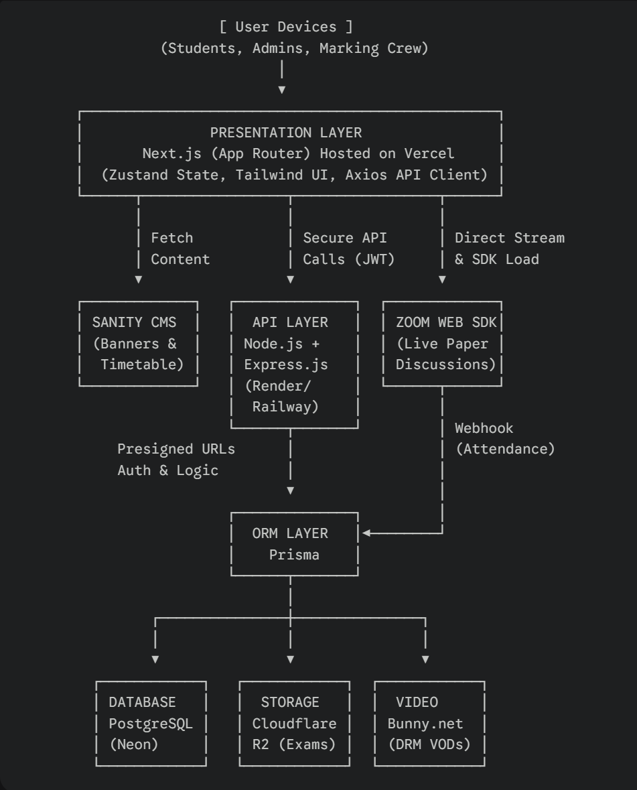
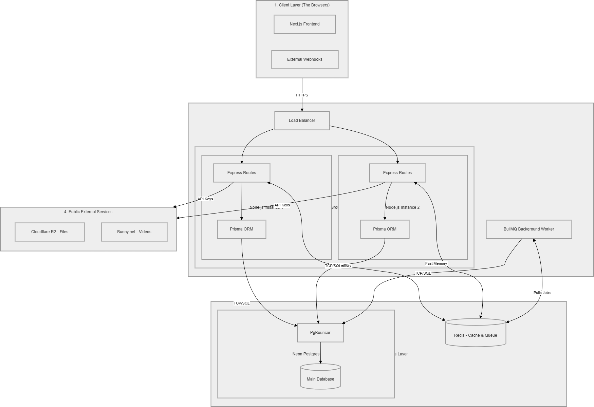
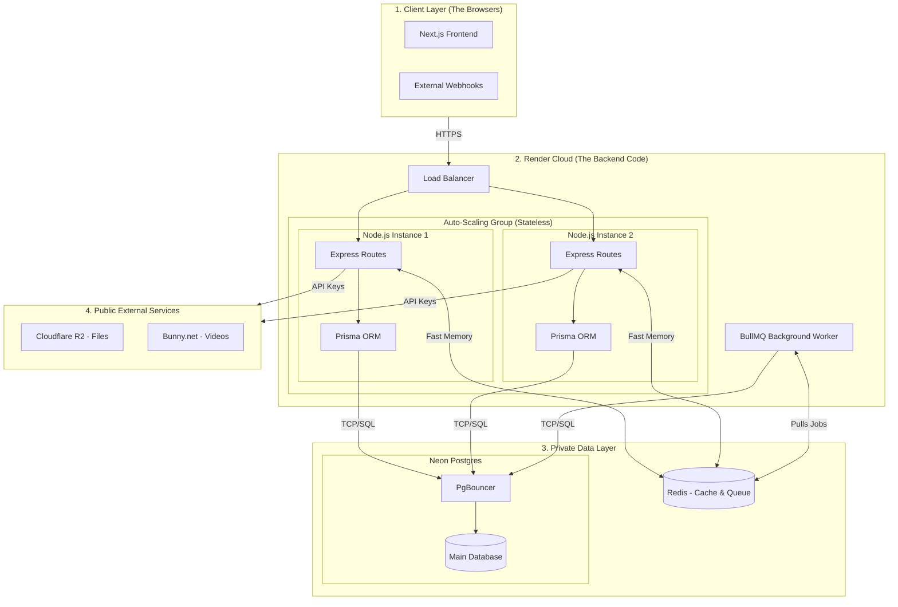
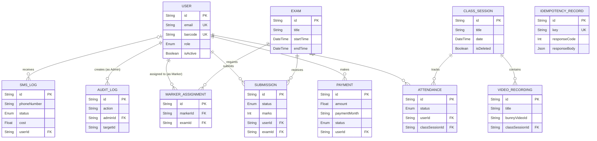

> ⚠️ **HISTORICAL BRAINSTORM — NOT THE SOURCE OF TRUTH.**
> This is the original whiteboard. It assumes **Render auto-scaling**, a **multi-instance** deployment, and an **older schema** (`Float` money, `isActive`, `PRESENT/ABSENT`, no Subject/Teacher). Those decisions were **superseded** on 2026-07-09.
>
> The system now targets **one small VPS + Docker Compose** (no Kubernetes, no auto-scaling), Neon Postgres + self-hosted Redis, a single Next.js frontend, roles `SUPER_ADMIN/TEACHER/ADMIN/MARKER/STUDENT`, and a `Subject → Course → …` hierarchy.
>
> **Read [`../documents/`](../documents/) for the current design** (start with `01-project-overview.md`). Keep this file only for the *reasoning* behind edge-case mitigations (thundering herd, idempotency, DRM, webhook storms, etc.), which remain valid.

---

# Whiteboard

[Summery](https://www.notion.so/Summery-35685bd4e92d80be9b8ef948d294dcfe?pvs=21)

## Chat Link:

[‎Gemini - direct access to Google AI](https://gemini.google.com/share/061f917dc968)

## How many User roles?

### 1. Super Admin

- **Role:** System owner and head lecturer
- **Powers**: **Absolute Control over system. Only one who can assign or change user roles, and have full access to all financial ,academic and user data**

### 2. Admin

- Institute managers or front desk stuff
- **Powers: Daily operations, scan student barcode at the entrance, upload monthly payment excel sheets, versify pending student accounts, and help students with access issues**
- They cannot change system settings or user roles

### 3. Paper Marking Crew

### 4. Student

## Tech Stack:

[Tech_Stack.pdf](Tech_Stack.pdf)

| **Layer / Category** | **Technology** | **Primary Role / Purpose** |
| --- | --- | --- |
| **Frontend Framework** | **Next.js (App Router) + TS** | Client UI, server-side rendering, and SEO optimization. |
| **Frontend State & Data** | **Zustand & Axios/React Query** | Cross-tab state synchronization and API data caching. |
| **Validation (Full-Stack)** | **Zod** (+ React Hook Form) | Strict type-checking and form validation before/after data transit. |
| **Backend API** | **Node.js + Express.js** | Core business logic using a stateless, 3-tier Controller-Service-Route architecture. |
| **Real-Time Data** | **Server-Sent Events (SSE)** | One-way HTTP streams pushing live updates (timers, attendance) to clients. |
| **Backend Security** | **Helmet.js & express-rate-limit** | HTTP header protection and IP-based rate limiting to prevent spam. |
| **Authentication** | **JWT (JSON Web Tokens)** | Secure user sessions stored in HTTP-only cookies. |
| **Primary Database** | **Neon (Serverless PostgreSQL)** | Relational source of truth for users, payments, and academic records. |
| **Database Middleware** | **Prisma & PgBouncer** | Type-safe ORM querying and connection pooling to survive auto-scaling. |
| **In-Memory Cache** | **Redis** | High-speed temporary storage for sessions, caching results, and Pub/Sub routing. |
| **Background Processing** | **BullMQ** | Task queue running on a separate worker to handle heavy jobs asynchronously. |
| **Secure File Storage** | **Cloudflare R2** | Zero-egress S3-compatible storage for exam PDFs via presigned URLs. |
| **Video Streaming** | **Bunny.net (Bunny Stream)** | VOD hosting with dynamic, IP-bound DRM to prevent piracy. |
| **Third-Party APIs** | **Zoom API & PayHere** | Webhook integrations for automated attendance and idempotent payments. |
| **Infrastructure / Host** | **Vercel & Render** | Vercel for the Next.js frontend; Render for auto-scaling Node.js backend/workers. |
| **Observability** | **Sentry & Pino** | Global crash reporting/error tracking (Sentry) and structured JSON logging (Pino). |

## Proposed Architecture



### The Data Flow Explained:

1. **Public Marketing Traffic:** When a new user hits the landing page, Next.js pulls the banners and schedules directly from **Sanity CMS**. Your Node.js server isn't even touched, keeping performance high.
2. **Standard API Traffic:** When an Admin logs in or updates a student's role, Next.js sends an Axios request with a JWT token to **Node.js**, which uses **Prisma** to update the **PostgreSQL** database.
3. **Heavy File Traffic (Exams):** When a student uploads an exam, Node.js acts only as a gatekeeper. It hands the student a secure "Presigned URL," and the student's device uploads the 5MB PDF directly into **Cloudflare R2**.
4. **Video & Live Classes:** Pre-recorded videos stream directly from **Bunny.net's** encrypted CDN to the browser. For live classes, the **Zoom SDK** runs entirely in the browser, but it secretly fires a webhook back to Node.js the second the student joins to log their attendance.

---

## Challenges expected and methods to overcome

### 1. PDF Upload Fails (The Disconnect)

If a student is uploading their 5MB exam PDF to Cloudflare R2 and the WiFi drops at 80%:

- **Frontend (Next.js):** The Axios upload request is configured with automatic retries. It will pause and try to reconnect for a few seconds.
- **Backend (Prisma):** Your database safely keeps their submission status as `"UPLOADING"`.
- **The Fix:** If the connection totally dies, the upload aborts. When they get back online, they just click "Upload" again. Node.js generates a fresh Presigned URL, and they start over. No corrupted partial files are saved.

### 2. The "Ghost" Upload (The Silent Success)

The worst-case scenario: The student's PDF successfully reaches Cloudflare R2, but their internet dies *before* Next.js can send the final `"I'm done!"` message to your Node.js server.

- **The Problem:** The file is safe in R2, but Prisma still says `"UPLOADING"`. The student thinks they failed.
- **The Fix (Webhooks):** We configure Cloudflare R2 to send a direct, backend-to-backend Webhook to your Node.js server the millisecond a file arrives. Your server updates Prisma to `"COMPLETED"` independently of the student's broken internet.

### 3. Video Stream Drops ([Bunny.net](http://bunny.net/))

If the internet cuts out while a student is watching a DRM-protected paper discussion:

- **The Fix:** Bunny Stream uses HLS (HTTP Live Streaming). It doesn't send the whole video; it sends tiny 3-second chunks. If the internet drops, the video player simply pauses. The moment the connection returns, it fetches the very next chunk and resumes perfectly. No need to refresh the page.

### 4. Typed Answers & Power Cuts (Next.js)

If students are typing answers directly into a text box on the website and the power goes out:

- **The Fix:** We use the browser's `localStorage` in Next.js. Every 5 seconds, whatever the student types is secretly saved directly to their own hard drive. If their PC dies, they turn it back on, open the LMS, and their text magically reappears in the box, ready to submit.

### 5.

- **The Zoom Web SDK on Mobile:** While it works beautifully on desktop, embedding Zoom directly into a browser can be notoriously laggy or restrictive on older mobile phones (especially Safari on older iPhones). We will need to test the mobile UI heavily.
- **The 50MB PDF Uploaders:** Even though Cloudflare R2 handles heavy files effortlessly, students will take uncompressed 4K photos of their physical exam papers and try to upload massive 50MB PDFs. We must build aggressive file-size limits and compression warnings directly into the Next.js frontend.
- **The "Day One" Support Avalanche:** Transitioning 1200 students to a new system is chaotic. On launch day, hundreds will type their barcodes wrong, forget their passwords, or claim they paid when the Excel sheet says they didn't. Your Main Admin will need a dedicated support channel just to handle the Day 1 onboarding wave.
- **Hardware "Focus Loss":** We solved the barcode tracking conceptually, but in reality, USB barcode scanners act like keyboards. If the Admin accidentally clicks away from the "Attendance Input" text box on their screen, the scanner will type the barcode into the void. We have to write strict React code to force the cursor to lock onto that input box.
- **Live Database Migrations:** Prisma makes database design easy, but if the client asks to change a core feature (like adding a "Half-Payment" status) *after* the app is live with 1200 active users, running a Prisma Migration without causing 5 minutes of downtime requires very careful DevOps planning.

### 6. Thundering Herd Problem

Imagine the Main Admin publishes the final exam results at exactly 8:00 PM. At 8:00:01 PM, all 1200 students refresh their dashboards at the exact same millisecond.

If your Node.js server sends 1200 identical requests directly to your Neon PostgreSQL database at once, the database CPU will instantly spike to 100%, and the server will crash.

**The Solution: Redis Caching**
To fix this, we introduce **Redis**, a lightning-fast, temporary "in-memory" database that sits directly between Node.js and PostgreSQL.

1. **The First Click (Cache Miss):** The very first student clicks "View Results." Node.js checks Redis. Redis says, "I don't have it." Node.js goes to PostgreSQL, gets the results, but *copies* that data into Redis before giving it to the student.
2. **The Herd Arrives (Cache Hit):** 10 milliseconds later, the other 1199 students click the button. Node.js checks Redis. Redis says, "I have it right here!" and instantly hands it to them from memory. PostgreSQL isn't even touched.

### 7. Time Traveler Exploit (NextJs Exam Timers)

- **The Edge Case:** You build a beautiful 60-minute countdown timer in Next.js for the MCQ exam. A smart student goes into their Windows/Mac settings and changes their system clock back by 30 minutes. If your React countdown relies on `Date.now()` or `new Date()`, their timer instantly gains 30 extra minutes.
- **The Fix:** **Never trust the client's clock.**
    - When the exam starts, the Node.js server records `startTime` in PostgreSQL.
    - The frontend timer is just a visual dummy.
    - When the student clicks "Submit," Node.js calculates `Server_Time - startTime`. If it is > 60 minutes, the server rejects the submission, regardless of what the student's screen said.

### 8. The 99% Upload Crash (Cloudflare R2 Presigned URLs)

- **The Edge Case:** For security, you set the Cloudflare R2 presigned upload URL to expire in 15 minutes. A student with a terrible 3G connection tries to upload a massive 40MB PDF of their essay. It takes them 16 minutes to reach 99%. At that exact moment, the URL expires, the upload is rejected by Cloudflare, and the student panics.
- **The Fix:** **Multipart Uploads & Dynamic Tokens.** In Next.js, slice the 40MB PDF into small 5MB chunks. Upload them one by one. If a token expires midway, Next.js catches the `403 Forbidden` error, silently asks your Node.js server for a *new* presigned URL, and resumes the upload from the exact chunk it failed on, completely invisible to the student.

### 9. The "Innocent Black Screen" (Bunny Stream DRM)

- **The Edge Case:** Your DRM is perfectly set up to block screen recording. A student who has fully paid and isn't pirating complains that the video is just a black screen with audio.
- **Why it happens:** DRM relies on HDCP (High-bandwidth Digital Content Protection). If the student plugs their laptop into a cheap external monitor using a faulty HDMI cable, the browser panics, thinks it's a capture card, and triggers the black screen defense.
- **The Fix:** **Proactive Error UI.** You cannot fix their HDMI cable, but you can stop them from flooding your Admin with support calls. In your Next.js video player component, detect if the video frame rate drops to 0 while audio plays. If so, display a massive overlay: *"Black screen? Disconnect external monitors or disable 'Hardware Acceleration' in your Chrome settings."*

### 10. The Webhook "Spam Storm" (Zoom Attendance)

- **The Edge Case:** A student is sitting in a café with spotty WiFi. They disconnect and reconnect to the Zoom Web SDK 45 times in a single hour. Zoom faithfully fires 45 "Student Joined" webhooks to your Node.js server. Your server tries to write to the Prisma `Attendance` table 45 times. Because you have a `@unique` constraint to prevent double attendance, Prisma throws 44 fatal collision errors.
- **The Fix:** **Upsert, not Create.** In your webhook controller, do not use `prisma.attendance.create()`. Use `prisma.attendance.upsert()`.
    - *Upsert logic:* "If the attendance record doesn't exist, create it. If it already exists, just update the `lastSeenAt` timestamp and ignore the collision." Your server stays quiet, and the database stays clean.

### 11. The "Multi-Tab Overwrite" (Frontend State)

- **The Edge Case:** A student opens the LMS essay exam in Tab A and writes a brilliant answer. They get distracted, open a new tab (Tab B) to check the timetable, but navigate back to the exam page. Tab B has a blank text box. They submit Tab A (success!), but then accidentally click submit on Tab B. Tab B overwrites their brilliant essay with a blank string in your database.
- **The Fix:** Use the browser's **Broadcast Channel API** or Zustand's cross-tab synchronization. If a student types in Tab A, Tab B instantly mirrors the text. If they submit in Tab A, Tab B instantly locks and shows "Exam Submitted."

### 12. The Accidental Cascade (Prisma Database Wipe)

- **The Edge Case:** An Admin realizes they made a typo in the title of last week's "Math Week 4" class. Instead of updating it, they click "Delete" to just recreate it. If your Prisma schema uses default relations, deleting that Class will trigger a **Cascade Delete**, instantly and permanently wiping out all 1,200 student attendance records tied to that class.
- **The Fix:** Implement **Soft Deletes**. In a production app, you never actually delete data. You add an `isDeleted DateTime?` field to your models. When the Admin clicks delete, you just set the timestamp and hide it from the UI. Alternatively, use Prisma's `onDelete: Restrict` rule, which strictly forbids the database from deleting a class if it has any attendance records attached to it.

### 13. The Telegram Pirate ([Bunny.net](http://bunny.net/) Bandwidth Bleed)

- **The Edge Case:** A smart student uses Chrome Developer Tools to extract the raw Bunny.net stream URL and the DRM authentication token. They post that link in a public Telegram group. 5,000 non-paying students click it. Bunny.net happily serves the video, and your client gets hit with a massive $500 CDN bandwidth bill.
- **The Fix:** **IP-Binding.** When your Node.js server generates the Bunny token, you must explicitly bind it to the student's current IP address (`req.ip`). If someone in a Telegram group clicks the link, Bunny.net sees their IP doesn't match the token's signature and instantly throws a `403 Forbidden`.

### 14. The "Zombie Cron Job" (Node.js Scaling)

- **The Edge Case:** You write a background script (`node-cron`) to run every midnight to revoke video access for students who haven't paid. When your app goes live, Render automatically scales your Node.js backend to **two servers** to handle the heavy traffic. At exactly midnight, *both* servers fire the script at the same time. They clash, lock the Prisma database, and send duplicate "Access Revoked" emails to the same students.
- **The Fix:** You cannot use standard `setTimeout` or `cron` in a multi-server environment. You must use a distributed task queue like **BullMQ** (which connects to your Redis instance). BullMQ acts as a manager; it holds the midnight task and gives it to exactly *one* server, ensuring it never runs twice.

We need to develop the backend, with auto-scaling in mind from day one.There is a massive difference between having 1,200 *registered* users who log in randomly throughout the month, and 1,200 *concurrent* users. If your client announces, "Exam results will be published at 8:00 PM," you will have 1,200 students hitting refresh at exactly 7:59:59 PM. A single Node.js instance on Render will choke on that many simultaneous HTTPS handshakes and Prisma queries.

When Render detects your server CPU spiking, it triggers **Horizontal Auto-Scaling**. It doesn't make your current server bigger; it spins up an exact clone of your server (Node 2), puts a Load Balancer in front of them both, and starts splitting the traffic 50/50.

If you don't write your code specifically to handle this "multi-server" reality, your app will break in bizarre ways. This is called the **Stateless Server Rule**.

### Here are the 4 strict rules you must follow when writing your Node.js code to ensure it survives Render's auto-scaling:


### 1. The "In-Memory" Trap

- **The Mistake:** You decide to build a quick feature to count active users on the dashboard. You write `let activeUsers = 0;` at the top of your controller.
- **The Failure:** When Render spins up Node 2, Node 2 has its own isolated memory. A student logs in and is routed to Node 1 (`activeUsers = 1`). Their friend logs in and is routed to Node 2 (`activeUsers = 1`). Your dashboard shows 1 user online instead of 2.
- **The Fix:** **Everything goes in Redis.** Your Node.js server must have "amnesia." It should hold zero state. If you need to count active users, both Node 1 and Node 2 must increment a shared `active_users` key inside your central Redis instance.

### 2. The Local File Upload Trap

- **The Mistake:** Using `multer` to save student profile pictures temporarily into a `/uploads` folder on the server before processing them.
- **The Failure:** Student A uploads a photo. The load balancer sends it to Node 1. The frontend then asks for the photo. The load balancer routes the request to Node 2. Node 2 looks in its local `/uploads` folder, finds nothing, and throws a `404 Not Found`.
- **The Fix:** **Direct-to-Cloud.** You already solved this perfectly with your Cloudflare R2 architecture. Because files never touch the Render server's local disk, auto-scaling will work flawlessly here.

### 3. The WebSocket Split-Brain

- **The Mistake:** You use `Socket.io` to show real-time notifications (like "The Admin has started the Zoom class!").
- **The Failure:** The Admin connects to Node 1 and sends the notification. Half your students are connected to Node 2. Node 1 has no idea how to talk to Node 2's connected students, so half the class misses the notification.
- **The Fix:** **Redis Pub/Sub.** If you use WebSockets, you must use the `socket.io-redis` adapter. It connects all your Node instances to the same Redis backbone, so a message broadcast from Node 1 is instantly relayed to Node 2's students.

### 4. The Database Connection Pool Limits

- **The Mistake:** You set your Prisma `connection_limit` to 50.
- **The Failure:** Node 1 opens 50 connections to PostgreSQL. Render scales up to 4 instances during an exam. Suddenly, your servers are demanding 200 connections. Neon Postgres might be configured to only allow 100 maximum connections. The database rejects the extra servers, and the whole system crashes.
- **The Fix:** **PgBouncer / Connection Pooling.** Neon Postgres provides a specific "Pooled Database URL". You must use this pooled URL in your `.env` file instead of the direct URL, allowing Neon to safely manage thousands of incoming requests from multiple Render instances.

---

## What Is Redis?

[What is Redis?](https://www.notion.so/What-is-Redis-35685bd4e92d8074a0c0f71c06a950f7?pvs=21)

(Horizontal  Scalling)

---

## For real time sever updates

### Server-Sent Events / SSE (The Sniper Rifle)

- **How it works:** The browser opens a single, long-lived HTTP connection, but it is **one-way**. The browser listens, and the server speaks. The frontend never sends data through this pipe; it only catches events pushed down by Node.js.
- **The Advantage:** It uses standard HTTP (no complex TCP handshake), consumes almost zero RAM, and works flawlessly with auto-scaling and load balancers.
- **Verdict:** **The absolute best choice for your LMS.**


---

## The DevOps Pipeline (CI/CD)

When your team is building new features (like a new graph for the dashboard), you cannot risk breaking the live system during exam week.

- **The Upgrade:** Set up **GitHub Actions**.
- **The Flow:** You create two environments: `Staging` and `Production`. When you write new code, you push it to a `staging` branch. GitHub automatically deploys it to a hidden test URL. Once your team tests it and confirms it works, you merge it to `main`, and it automatically updates the live Vercel and Render servers with zero downtime.

---

### 1. The JWT Expiration Trap (The Lost Essay)

- **The Logic Failure:** You set the JWT (login token) to expire after 2 hours for security. A student logs in, opens an online essay exam, and spends 2.5 hours typing an incredible answer. When they click "Submit," your Node.js middleware sees an expired token, rejects the request (`401 Unauthorized`), and the browser refreshes. Their 2.5 hours of work is instantly deleted.
- **The Architectural Fix:**
    - **Silent Refresh:** Implement a "Refresh Token" system. While the student is typing, the Next.js frontend silently pings the backend every 15 minutes to grab a fresh token in the background.
    - **The Failsafe:** Right before Axios sends the `POST` request to submit the exam, force Next.js to save the essay text into the browser's `localStorage`. If the server rejects the upload, the data is still safe on their hard drive.

### 2. The Next.js "Aggressive Cache" Trap

- **The Logic Failure:** Next.js (App Router) is famously aggressive about caching pages to make them load fast. Your Admin updates the class timetable in Sanity CMS for tomorrow's urgent change. However, because Next.js cached the HTML of the landing page an hour ago, all 1200 students are still seeing the old timetable.
- **The Architectural Fix:** Implement **On-Demand Revalidation (ISR)**. When the Admin hits "Publish" in Sanity, Sanity fires a webhook to a specific Next.js API route (e.g., `/api/revalidate`). This tells Next.js to instantly destroy the old cache for that specific page and rebuild it with the fresh timetable, without requiring you to redeploy the whole website.

### 3. The Webhook Black Hole (Silent Failures)

- **The Logic Failure:** We rely on Zoom to send a Webhook to Node.js to mark a student's attendance. But what if your Render server happens to be auto-restarting at the exact millisecond Zoom sends that webhook? Zoom assumes the message was delivered, your server never receives it, and the student is permanently marked absent.
- **The Architectural Fix:**
    - **Idempotency & Retries:** Configure Zoom/Cloudflare webhooks to automatically retry if they don't get a `200 OK` response from your server.
    - **The Reconciliation Script:** Build a "Sync" button for the Admin dashboard. If a student complains they attended but were marked absent, the Admin clicks "Sync." Your Node.js server actively reaches out to the Zoom API, pulls the complete historical attendance log for that specific meeting ID, and forcefully updates the Prisma database to patch any holes.

### 4. The Database Race Condition (Double Clicking)

- **The Logic Failure:** A student's internet is lagging. They click the "Pay Monthly Fee" button twice in frustration. The frontend sends two identical Axios requests 50 milliseconds apart. The Node.js controller checks the first request, sees the student hasn't paid, and creates a payment record. 50ms later, the second request arrives. Because the database hasn't finished writing the first payment, the controller still thinks the student hasn't paid, and creates a *second* payment record, charging their card twice.
- **The Architectural Fix:**
    - Can fix by using an idempotency key
    - Flow:
        
        **1. The Client (Next.js)**
        When a student opens the "Pay May Fees" screen, Next.js generates a unique ID (a UUID) specifically for that payment attempt. When they click "Pay", Next.js attaches this UUID to the Axios request headers.
        
        **2. The Bouncer (Node.js Middleware)**
        You create a specific piece of middleware for your payment route. Before the request reaches your controller, the middleware checks the headers for the `Idempotency-Key`.
        
    - How it handles the "Double Click" Panics
        - **Request 1 Arrives:** Node.js checks Prisma. The key `abc-123` doesn't exist. Node.js processes the payment, saves the key and the receipt to `IdempotencyRecord`, and sends a success message back to the student.
        - **Request 2 Arrives (50ms later because the student double-clicked):** Node.js checks Prisma. It sees `abc-123` already exists. It immediately stops processing, skips the payment gateway entirely, and simply hands back the cached JSON receipt from the first request. The student is charged once, but their frontend receives a "Success" message for both clicks.

---

### To where we use idempotency key (High-Stakes Requests (REQUIRE THE KEY)

You only apply your custom Idempotency Middleware to routes that create *new* permanent records (`POST` requests) where a duplicate would cause chaos.

- **`/api/payments/payhere`:** As we discussed, you cannot charge a student twice for the May fees.
- **`/api/exams/finalize-marks`:** When the Marking Crew submits a final exam score, you don't want a network lag to accidentally create two separate score entries for the same student.
- **`/api/accounts/activate`:** When the Admin clicks "Activate" on a physical student's barcode, you only want one activation record, not three.
- Here is the best rule of thumb to decide when to use one. Ask yourself the **"Pain Test"**: *If a network glitch causes this exact request to happen twice, how bad is the damage?*
    
    **1. Low Pain (Skip the Key, rely on the Frontend)**
    
    - **Example:** A student posts a comment in a class discussion board (`POST /api/comments`).
    - **The Result:** If they double-click and it posts twice, it's just mildly annoying. The student can just click "delete" on the duplicate.
    - **The Fix:** Just disable the submit button on the frontend (Next.js) for 2 seconds after they click it.
    
    **2. High Pain (Use the Idempotency Key)**
    
    - **Example:** Charging a student's credit card (`POST /api/payments`) or finalizing an exam score (`POST /api/exams/finalize`).
    - **The Result:** If this duplicates, a student loses $30 unfairly, or their transcript is permanently corrupted. This requires manual database surgery by your Admin to fix.
    - **The Fix:** Use the strict Idempotency Key middleware we discussed.

# Backend Node Js Server

We are going to use the industry-standard **3-Tier Architecture** (also known as the Controller-Service-Route pattern). It keeps your code modular, prevents bugs, and makes adding new features incredibly fast.

## Proposed Folder structure






## 3 Rules for 3-Tier Architecture

**1. The Route (The Traffic Cop)**

- **Job:** Defines the URL endpoint and applies the security middleware.
- **Rule:** *Never write business logic here.*
- Example (`routes/payment.routes.ts`):
    - 
    
    ```tsx
    router.post('/pay', verifyToken, checkIdempotency, PaymentController.process);
    ```
    

**2. The Controller (The Waiter)**

- **Job:** Extracts data from the student's request (`req.body`), passes it to the Service layer, and sends the final JSON response back (`res.status(200).json(...)`).
- **Rule:** *Never write Prisma queries here.* Keep it extremely thin.

**3. The Service (The Kitchen)**

- **Job:** This is where the heavy lifting happens. The Service layer calculates totals, checks conditions, and makes the actual calls to Prisma or Cloudflare.
- **Rule:** *This is the only folder allowed to talk to the database or 3rd party APIs.*
- **Why?** If you ever need to process a payment from a completely different part of the app (like a cron job), you just call `PaymentService.process()` without needing a fake HTTP request.

---

## Safety Nets

### **1. The Bouncer: Strict Input Validation (Zod)**

Never trust the frontend. Even if your Next.js form requires an email, a malicious user can bypass the browser and send raw data directly to your server using a tool like Postman.

- **The Fix:** Use a library called **Zod**.
- **How it fits:** It acts as middleware right before your Controller. If an Admin tries to upload a schedule but accidentally sends a text string instead of a Date, Zod instantly intercepts it, blocks the request, and sends a polite `400 Bad Request` back to the user. Your Controller only ever processes 100% perfectly formatted data.

### **2. The Safety Net: The Global Error Handler**

If your Neon database temporarily drops connection, or Bunny.net takes too long to respond, a standard Node.js server will completely crash and restart.

- **The Fix:** You place one single "Global Error Handler" at the very bottom of your `index.ts` file.
- **How it fits:** If *any* function in your entire app fails, you just `throw new Error()`. The global handler catches it, silently alerts you (via Sentry or console logs), and sends the student a clean, uniform JSON response: `{ "error": "System busy, please try again." }`. The server stays alive.

---

## Communication Pathways in our LMS

### 1. The Front Door: REST over HTTPS

This is how the outside world talks to your backend.

- **Who uses it:** The Next.js frontend, Zoom Webhooks, PayHere Webhooks.
- **The Flow:** The Next.js client sends a secure JSON payload (e.g., `POST /api/payments`). It hits your Load Balancer, gets routed to one of your Node.js servers, passes through the Bouncers (Middleware/Zod), and reaches the Controller.

### 2. The Internal Highway: RESP (Redis Serialization Protocol)

This is the lightning-fast, internal language your Node.js servers use to talk to Redis.

- **Who uses it:** Node.js Controllers, Node.js Background Workers.
- **The Flow:** Because Redis lives in memory, communication here takes fractions of a millisecond. If Node Server 1 needs to know if a session is valid, or if it needs to drop a heavy task into the BullMQ queue, it speaks RESP directly to the Redis instance.

### 3. The Database Pipeline: TCP/IP via PgBouncer

Node.js does not speak SQL. It speaks JavaScript. Prisma is the translator, but to actually send that translated SQL to Neon PostgreSQL, it uses a dedicated TCP connection.

- **Who uses it:** The Service layer (Prisma Client).
- **The Flow:** Your Node.js server opens a connection to a "Connection Pooler" (PgBouncer) sitting in front of your Neon database. This prevents 1,200 students from opening 1,200 individual database connections and crashing PostgreSQL.

### 4. The Megaphone: Server-Sent Events (SSE)

This is how your backend pushes real-time updates down to the students without them asking.

- **Who uses it:** Node.js broadcasting to Next.js.
- **The Flow:** A one-way, open HTTP stream. When an Admin updates a score, Node.js shouts it down this open pipe, and the React frontend catches it to update the UI instantly.

---

## Day-2 Operations

### 1. Asynchronous Background Jobs (The Message Queue)

Right now, if an Admin clicks "Publish Exam Results," your server has to send 1,200 emails to students. If your Node.js controller tries to send 1,200 emails in the same thread, the server will "block." For the next 30 seconds, anyone trying to load the website will just see a spinning loading wheel.

**The Fix: BullMQ + Redis**
Instead of doing the work immediately, your main server just writes a "To-Do List" in Redis. A completely separate, hidden server (a "Worker") reads that list and sends the emails one by one in the background. The main server instantly responds to the Admin: *"Emails are sending!"* and goes back to serving web pages.

### 2. Observability (Killing `console.log`)

When you deploy to Render with auto-scaling, `console.log` becomes useless. If an error happens on Node Server 2, but you are looking at the logs for Node Server 1, you will never see it.

- **Structured Logging (Pino/Winston):** These libraries format your logs as JSON so they can be easily searched later.
- **Error Tracking (Sentry):** You install the Sentry SDK. If a student's Next.js app crashes or your Node.js server throws an unhandled database error, Sentry instantly sends a message to your team's Slack/Discord with the exact line of code that failed and the student's ID.

### 3. API Security (Helmet & Rate Limiting)

Because you have a public login page, bots will try to brute-force student passwords or spam your endpoints.

- **Helmet.js:** A simple Express middleware that hides metadata about your server and locks down HTTP headers, preventing cross-site scripting (XSS) attacks.
- **Distributed Rate Limiting:** Using `express-rate-limit` connected to Redis. If a single IP address tries to hit the `/api/login` route more than 10 times in one minute, Redis temporarily bans their IP. Because it's in Redis, the ban applies across all your auto-scaled servers instantly.

---

## SMS Service

[Pricing - Notify.lk](https://www.notify.lk/pricing/)


- Use Lite package

---

# Hosting

We only buy one domain and, use sub domain to route traffic to backend.

Industry-standard way to deploy a Next.js and a Node.js backend using single domain name (let’s pretend your domain is academiclms.com)

1. The Frontend gets the Main Domain

You will deploy your Next.js application to **Vercel**.
In Vercel’s dashboard, you will link your newly purchased domain.

- **URL:** `academylms.com` (and `[www.academylms.com](https://www.academylms.com)`)
- **What happens:** When a student types this into their browser, the internet routes them directly to Vercel's servers, which instantly loads your Next.js React UI.

2. The Backend gets the "API" Subdomain

You will deploy your Node.js application to **Render**. By default, Render gives you an ugly URL like `lms-backend-xyz.onrender.com`. You don't want the frontend talking to that. Instead, you create a subdomain.

- **URL:** `api.academylms.com`
- **What happens:** You configure your domain registrar (like Namecheap or Cloudflare) to say: *"If anyone goes to the `api` subdomain, don't send them to Vercel. Send them to Render instead."*

3. The Exact DNS Setup (How to wire it together)

When you buy your domain, you will access a DNS (Domain Name System) settings page. You will add two specific records to connect Vercel and Render:

1. **The Frontend Record (Vercel):** You add an `A Record` or `CNAME` for the root `@` domain pointing to Vercel's IP address.
2. **The Backend Record (Render):** You add a `CNAME Record` for `api` pointing to your Render server (`lms-backend.onrender.com`).

Here is an interactive simulator showing exactly how internet traffic reads these DNS records and routes your students to the right servers:


[STEPS](https://www.notion.so/STEPS-35785bd4e92d805184e1c36c3d9d6dc4?pvs=21)

---

# DATABASE

```tsx
generator client {
  provider = "prisma-client-js"
}

datasource db {
  provider = "postgresql"
  url      = env("DATABASE_URL")
}

// ==============================
// ENUMS (Strict Data Typing)
// ==============================
enum Role {
  SUPER_ADMIN
  ADMIN
  MARKER
  STUDENT
}

enum AttendanceStatus {
  PRESENT
  ABSENT
}

enum PaymentStatus {
  PENDING
  SUCCESS
  FAILED
}

enum SubmissionStatus {
  UPLOADING
  COMPLETED
}

enum SmsStatus {
  PENDING
  SENT
  FAILED
}

// ==============================
// CORE MODELS
// ==============================

model User {
  id        String   @id @default(uuid())
  email     String   @unique
  name      String
  password  String
  barcode   String?  @unique 
  role      Role     @default(STUDENT)
  isActive  Boolean  @default(true) 

  // Relationships
  payments          Payment[]
  attendance        Attendance[]
  submissions       Submission[]
  auditLogs         AuditLog[]         @relation("AuditAdmin")
  markerAssignments MarkerAssignment[] @relation("AssignedMarker")
  smsLogs           SmsLog[]

  createdAt DateTime @default(now())
  updatedAt DateTime @updatedAt

  @@index([email])
}

// Prevents the "Double Click" payment bug
model IdempotencyRecord {
  id           String   @id @default(uuid())
  key          String   @unique // The UUID sent by Next.js
  responseCode Int
  responseBody Json     // Caches the success message
  createdAt    DateTime @default(now())

  @@index([key])
}

model Payment {
  id           String        @id @default(uuid())
  amount       Float
  status       PaymentStatus @default(PENDING)
  payhereId    String?       @unique 
  paymentMonth String        // Format: "YYYY-MM"
  
  userId       String
  user         User          @relation(fields: [userId], references: [id])

  createdAt    DateTime      @default(now())

  @@index([userId, paymentMonth]) 
}

// ==============================
// SYSTEM LOGS & AUDITS
// ==============================

model AuditLog {
  id          String   @id @default(uuid())
  action      String   // e.g., "CLASS_DELETED", "PAYMENT_OVERRIDDEN"
  description String?  // Optional details like "Admin manually approved Jan payment"

  adminId     String
  admin       User     @relation("AuditAdmin", fields: [adminId], references: [id])

  targetId    String?  // ID of the user, class, or payment affected

  createdAt   DateTime @default(now())

  @@index([adminId])
  @@index([action])
}

model SmsLog {
  id          String    @id @default(uuid())
  phoneNumber String
  message     String
  status      SmsStatus @default(PENDING)
  cost        Float?    // Cost per SMS from Notify.lk (e.g., 1.10)

  userId      String?   // Optional: Link it to a specific student if applicable
  user        User?     @relation(fields: [userId], references: [id])

  createdAt   DateTime  @default(now())

  @@index([phoneNumber])
}

// ==============================
// ACADEMIC MODELS
// ==============================

model ClassSession {
  id          String   @id @default(uuid())
  title       String   
  date        DateTime
  zoomLink    String?
  isDeleted   Boolean  @default(false) 

  attendance      Attendance[]
  videoRecordings VideoRecording[]
}

model Attendance {
  id             String           @id @default(uuid())
  status         AttendanceStatus @default(PRESENT)
  scannedAt      DateTime         @default(now()) 

  userId         String
  user           User             @relation(fields: [userId], references: [id])
  
  classSessionId String
  classSession   ClassSession     @relation(fields: [classSessionId], references: [id])

  @@unique([userId, classSessionId]) 
}

model VideoRecording {
  id             String   @id @default(uuid())
  title          String
  bunnyVideoId   String   
  
  classSessionId String
  classSession   ClassSession @relation(fields: [classSessionId], references: [id])

  createdAt      DateTime @default(now())
}

// ==============================
// EXAM MODELS
// ==============================

model Exam {
  id          String   @id @default(uuid())
  title       String
  paperPdfUrl String   
  startTime   DateTime 
  endTime     DateTime
  isDeleted   Boolean  @default(false)

  submissions       Submission[]
  markerAssignments MarkerAssignment[]
}

// Links a specific Marker to grade a specific Exam
model MarkerAssignment {
  id        String   @id @default(uuid())

  markerId  String
  marker    User     @relation("AssignedMarker", fields: [markerId], references: [id])

  examId    String
  exam      Exam     @relation(fields: [examId], references: [id])

  assignedAt DateTime @default(now())

  @@unique([markerId, examId]) // A marker cannot be assigned to the same exam twice
}

model Submission {
  id           String           @id @default(uuid())
  status       SubmissionStatus @default(UPLOADING) 
  answerPdfUrl String?          
  marks        Int?             

  userId       String
  user         User             @relation(fields: [userId], references: [id])

  examId       String
  exam         Exam             @relation(fields: [examId], references: [id])

  submittedAt  DateTime         @default(now())

  @@unique([userId, examId]) 
}

```

## ER Diagram

